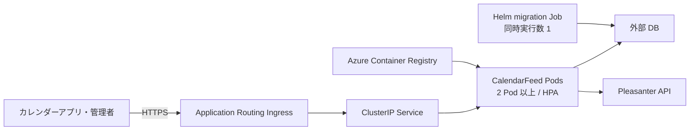

# AKS 導入更新運用手順書

## 対象と前提

本書は、本アプリを既存の Azure Kubernetes Service（AKS）へ Helm で導入し、
Azure Container Registry（ACR）のイメージへ更新する手順を定める。
AKS クラスター自体の作成、DB と Pleasanter の構築は対象外とする。
Questionnaire の `AKS-導入更新運用手順書.md` に倣い、**本アプリに無いもの（サブパス配置・Data Protection の鍵束）は除いた**。

> ⚠️ **AKS の実機では未検証**。確認したのは `helm lint` と `helm template` での描画までである
> （チャート作成時。実機で通したら、この注記を更新すること）。

必要なものは次のとおり。

- AKS クラスター、ACR、外部 DB（SQL Server / PostgreSQL / MySQL）、Pleasanter が構築済み
- ローカルに Azure CLI、`kubectl`、Helm 4 または Helm 3
- AKS から DB と Pleasanter へ到達できるネットワーク（DB は TLS）
- ACR からイメージを pull できる AKS の権限
- Ingress を公開する場合は DNS 名と TLS 証明書

本リポジトリのチャートは `deploy/aks/calendarfeed/` にある。
AKS Deployment Safeguards を前提に、非 root、読み取り専用ルートファイルシステム、
リソース要求・上限、probe、2 Pod 以上、PodDisruptionBudget を設定している。

## 構成



- `/healthz` はプロセスの生存、`/ready` は本アプリ DB への接続を確認する。**Pleasanter は確認しない**
  （Pleasanter の一時停止で、購読の応答が 503 になるだけで、Pod を負荷分散から外す理由にはならない）
- **複数 Pod で動かせる。** セッション・レート制限・メール送信・マイグレーションの排他は、すべて DB で共有する
  （[`導入-更新運用手順書.md`](導入-更新運用手順書.md)「複数台での運用」）。**サーバ側に残る状態は無いので、PVC は要らない**
- **SQLite は使えない**（複数 Pod で共有できない）。チャートの `config.dbProvider` は SqlServer / PostgreSql / MySql のみ

## 事前設定

### ACR と AKS を接続する

AKS の kubelet identity が ACR から pull できるようにする。

```bash
az aks update \
  --resource-group <AKSリソースグループ> \
  --name <AKS名> \
  --attach-acr <ACR名>

az aks get-credentials \
  --resource-group <AKSリソースグループ> \
  --name <AKS名>
```

組織の方針で `--attach-acr` を使えない場合は、ACR の権限モデルに合わせて
kubelet identity へ pull の最小権限を割り当てる。

### Namespace と資格情報を作る

資格情報を Helm values に書くと Helm release history に残る。
チャートは Secret を作らず、事前作成した Secret の名前だけを参照する。

```bash
kubectl create namespace calendarfeed
```

次のファイルを安全な作業場所へ作る。リポジトリへ置かず、利用後に安全に削除する。

```text
CALENDARFEED_DB_CONNECTIONSTRING=<本アプリDBの接続文字列>
CALENDARFEED_SECRET_KEY=<Base64の32バイト鍵>
```

- `CALENDARFEED_SECRET_KEY` の作り方: `docker run --rm <イメージ> --generate-secret-key`
  （コンテナの入口がアプリなので、引数だけ渡せばよい）
- 全フィード共通の既定の API キー（`CALENDARFEED_PLEASANTER_APIKEY`）は**任意**。通常はフィードごとに管理画面から登録する

Secret を作成する。

```bash
kubectl create secret generic calendarfeed-secrets \
  --namespace calendarfeed \
  --from-env-file=.calendarfeed-secrets.env
```

**`CALENDARFEED_SECRET_KEY` は紛失すると、登録済みのフィードの API キーと管理者の 2 要素を復号できない**
（API キーの登録し直しになる）。Azure Key Vault 等へ控えを保管する。Secret の更新は同名で再生成して適用する。

```bash
kubectl create secret generic calendarfeed-secrets \
  --namespace calendarfeed \
  --from-env-file=.calendarfeed-secrets.env \
  --dry-run=client -o yaml | kubectl apply -f -
```

### Ingress と TLS を用意する

AKS Application Routing add-on を使う場合、Ingress class は
`webapprouting.kubernetes.azure.com` とする。TLS Secret を先に作る。

`config.forwardedNetworks` には Application Routing Ingress からアプリ Pod へ接続するときの
送信元 CIDR だけを指定する。これは `X-Forwarded-For` と `X-Forwarded-Proto` を信頼する範囲で、
**IP ごとのレート制限が実際のクライアントの IP で効く**ために要る。
無関係な VNet 全体や `0.0.0.0/0` を指定しない。ネットワーク方式により Pod CIDR または
Ingress node/subnet の CIDR になるため、クラスター管理者が実際の構成から確定する。
**Ingress を有効にするとき、1 件以上の指定が必須**（`values.schema.json` が止める）。

```bash
kubectl get pods --namespace app-routing-system -o wide
kubectl get nodes -o wide

kubectl create secret tls calendarfeed-tls \
  --namespace calendarfeed \
  --cert=calendarfeed.crt \
  --key=calendarfeed.key
```

証明書を別の仕組みで管理する場合は、同名の TLS Secret が作られるようにする。
**Ingress を有効にする場合は host と TLS Secret の両方が必須**である。

### Pleasanter のログインで管理画面へ入る場合

`config.pleasanterSso.<項目>` を values へ書くと `CALENDARFEED_PLEASANTERSSO_<項目の大文字>` として渡る。

- **書いた項目だけを渡す。** 外部設定に値がある項目は管理画面から変えられなくなるため、既定では 1 つも渡さず、
  `null` と空文字も渡さない。管理画面から設定する運用なら書かなくてよい。秘密を含む項目は無いので ConfigMap に載せる
- 項目は `enabled`・`internalBaseUrl`・`loginUrl`・`logoutUrl`・`cookieNames`・`unknownUser`・`registerRole`・
  `revalidateMinutes`・`timeoutSeconds`・`buttonLabel`。綴り違いは `values.schema.json` が止める
- **`internalBaseUrl` はクラスター内の Pleasanter の Service を直接指してよい**
  （例 `http://pleasanter.pleasanter.svc.cluster.local`）。`loginUrl`・`logoutUrl` はブラウザが開くので、
  **本アプリと Pleasanter を同じホスト名に置く**必要がある（Cookie を共有するため）。
  本アプリは**サブパス配置に未対応**なので、同じホスト名に置けない構成では使えない
  （[`導入-更新運用手順書.md`](導入-更新運用手順書.md)「Pleasanter のログイン」）

`values-pleasanter-sso.example.yaml` は、`values-production.example.yaml` に重ねて使う例。

```bash
helm template calendarfeed deploy/aks/calendarfeed \
  --namespace calendarfeed \
  --values calendarfeed-production.yaml \
  --values deploy/aks/calendarfeed/values-pleasanter-sso.example.yaml
```

## イメージを ACR へ発行する

`.github/workflows/aks-image.yml` を手動実行する。GitHub Environment
`aks-production` に次の Repository/Environment variables を設定する。

| 変数 | 内容 |
| --- | --- |
| `AZURE_CLIENT_ID` | GitHub OIDC で使う Microsoft Entra アプリまたは user-assigned managed identity |
| `AZURE_TENANT_ID` | Microsoft Entra tenant ID |
| `AZURE_SUBSCRIPTION_ID` | ACR のある subscription ID |
| `AZURE_ACR_NAME` | ACR 名。`azurecr.io` は付けない |

Azure 側には GitHub Environment `aks-production` を subject とする federated credential を作り、
対象 identity へ ACR Tasks のビルド送信に必要な最小権限を割り当てる。
GitHub へ client secret は登録しない。

`source_ref` にはリリース済みタグまたは確定したコミット SHA を指定する。
`image_tag` を省略すると、そのコミット SHA の先頭 12 桁を使う。上書き可能な `latest` は禁止している。

```bash
gh workflow run aks-image.yml \
  -f source_ref=<タグまたはコミット> \
  -f image_tag=<イメージタグ>
```

Actions の Summary に、発行したイメージ名と digest が出る。

## 初回導入

`values-production.example.yaml` を作業場所へコピーし、ACR、Pleasanter URL、
`forwardedNetworks`、公開 host、TLS Secret 名を環境に合わせる。
例の `10.244.0.0/16` は仮値なので必ず置き換える。資格情報は書かない。

```bash
cp deploy/aks/calendarfeed/values-production.example.yaml calendarfeed-production.yaml

helm lint deploy/aks/calendarfeed \
  --values calendarfeed-production.yaml

helm upgrade --install calendarfeed deploy/aks/calendarfeed \
  --namespace calendarfeed \
  --values calendarfeed-production.yaml \
  --atomic \
  --wait \
  --timeout 10m
```

Helm の `pre-install` hook がマイグレーション Job を 1 Pod だけ起動し（`--migrate --wait-for-db=…`）、
成功してから Deployment を作る。DB 接続に失敗するかマイグレーションに失敗した場合、導入は止まる。
アプリ Pod の起動時の自動適用（`CALENDARFEED_DB_AUTOMIGRATE`）は既定で有効で、チャートは既定ではこの値を渡さない。
hook が先に当て終えているので、Pod は未適用が無いことを確かめるだけで起動する。
複数 Pod が同時に起動しても DB の排他で 1 台だけが当てる。

| 値 | 渡す環境変数 | 既定 | 内容 |
| --- | --- | --- | --- |
| `migration.autoMigrateOnStartup` | `CALENDARFEED_DB_AUTOMIGRATE` | `null`（渡さない。アプリの既定の `true`） | `false` で Pod 起動時の自動適用を止める |

アプリ用の DB アカウントからスキーマ変更の権限を外す場合は `migration.autoMigrateOnStartup: false` にする。
**ただし hook Job も同じ Secret の `CALENDARFEED_DB_CONNECTIONSTRING` を使う**ので、チャートだけでは
Job と Pod の権限を分けられない。

確認する。

```bash
kubectl get deploy,pod,service,ingress,hpa,pdb --namespace calendarfeed

kubectl rollout status deployment/calendarfeed-calendarfeed \
  --namespace calendarfeed \
  --timeout=5m

curl --fail https://calendarfeed.example.com/healthz
curl --fail https://calendarfeed.example.com/ready
```

リソース名は release 名と chart 名から作る。`calendarfeed` 以外の release 名を使った場合は
`kubectl get` で実名を確認する。**管理画面は `https://<host>/admin`**。初回は初期設定の画面が出る。

## 更新

DB のバックアップを取得し、新イメージを ACR へ発行してから values の `image.tag` を更新する。
マイグレーション内容と後方互換性は Release 本文で確認する。

適用前に、Helm 標準の `template` でレンダリング結果をレビューする。

```bash
helm template calendarfeed deploy/aks/calendarfeed \
  --namespace calendarfeed \
  --values calendarfeed-production.yaml > rendered.yaml
```

適用する。

```bash
helm upgrade calendarfeed deploy/aks/calendarfeed \
  --namespace calendarfeed \
  --values calendarfeed-production.yaml \
  --atomic \
  --wait \
  --timeout 10m
```

`pre-upgrade` hook のマイグレーションが先に成功し、その後 Deployment が
`maxUnavailable: 0` でローリング更新される。更新後は初回導入と同じ確認を行う。

## 失敗時とロールバック

### migration Job を調べる

成功した hook Job は自動削除する。失敗した Job は調査のため残す。

```bash
kubectl get jobs --namespace calendarfeed
kubectl logs job/calendarfeed-calendarfeed-migrate --namespace calendarfeed
kubectl describe job calendarfeed-calendarfeed-migrate --namespace calendarfeed
```

接続文字列、DB のファイアウォール、名前解決、TLS 設定を直してから同じ `helm upgrade` を再実行する。

### アプリをロールバックする

```bash
helm history calendarfeed --namespace calendarfeed
helm rollback calendarfeed <REVISION> \
  --namespace calendarfeed \
  --wait \
  --timeout 10m
```

Helm rollback では `pre-upgrade` hook を実行しない。DB マイグレーションは自動で戻らない。
旧アプリと新 DB に後方互換性がない場合は、先に取得した DB バックアップから復元するか、
互換性を戻す修正版イメージを発行する。判断できない場合は Pod だけを戻さない。

### Pod が Ready にならない

```bash
kubectl get pods --namespace calendarfeed
kubectl describe pod <Pod名> --namespace calendarfeed
kubectl logs <Pod名> --namespace calendarfeed
kubectl get events --namespace calendarfeed --sort-by=.lastTimestamp
```

- `/healthz` が失敗する: プロセス起動、ポート、リソース不足を確認する
- `/ready` だけ失敗する: DB 接続、Secret、名前解決、TLS、ファイアウォールを確認する
- ImagePullBackOff: AKS kubelet identity の ACR pull 権限とイメージタグを確認する
- 購読が 502 になる: フィードの API キーを復号できない（`CALENDARFEED_SECRET_KEY` を変えた）。API キーを登録し直す

## バックアップと定期確認

- DB は組織の RPO/RTO に合わせてバックアップと復元試験を行う
- `CALENDARFEED_SECRET_KEY` の控えを Key Vault 等で保全する
- TLS 証明書と OIDC federated credential の期限・subject を定期確認する
- HPA の replica 数、CPU/メモリ、再起動回数、`/ready` の失敗を監視する
- **Pleasanter の API の回数の上限**（サイトごと・1 日ごと）に注意する。Pod を増やしても、取りに行く回数は
  フィードのキャッシュ秒数で決まる（[`導入-更新運用手順書.md`](導入-更新運用手順書.md)「API の回数の上限」）
- AKS、node image、Ingress の更新方針をクラスター運用側で定める

## 参照した一次情報

Questionnaire の同名手順書が参照したもの（Questionnaire 側で 2026-08-30 / 2026-09-25 参照）に倣った。
**本リポジトリでは URL の内容を取り直していない**ので、実機で導入する前に一次情報で確かめること。

- [AKS Deployment Safeguards](https://learn.microsoft.com/azure/aks/deployment-safeguards)
- [AKS Application Routing](https://learn.microsoft.com/azure/aks/app-routing)
  — NGINX のアドオンへの Microsoft のサポートは 2026 年 11 月まで。後継は Gateway API。
  このチャートは Ingress だけを描き、Gateway API の HTTPRoute は描かない
- [ACR Tasks の概要](https://learn.microsoft.com/azure/container-registry/container-registry-tasks-overview)
- [GitHub Actions から Azure への OpenID Connect](https://learn.microsoft.com/azure/developer/github/connect-from-azure-openid-connect)
- [Helm chart hook](https://helm.sh/docs/topics/charts_hooks/)
