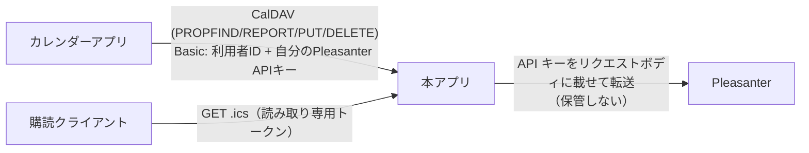
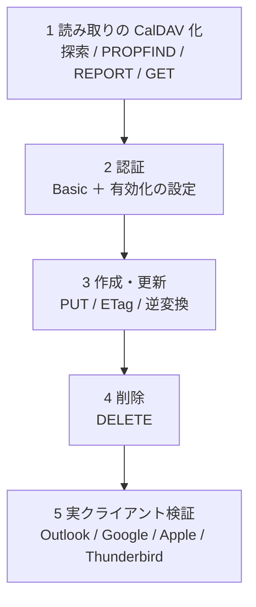

# CalDAV 書き込み 設計方針

カレンダーアプリから予定を作成・更新・削除し、Pleasanter のレコードへ反映するための設計方針。
**実装はこの文書の対象外**（別 Issue）。Issue #73。

> 状態: **段階 1・2（探索・読み取り・Basic 認証・有効化の設定）は実装済み**（Issue #85）。書き込み（段階 3・4）は未実装。
> 実機で確かめた事項は実機検証結果 14・15 章。

## 1. 決定事項（2026-10-15、利用者の回答）

| 項目 | 決定 |
| --- | --- |
| 認証と書き手 | **利用者ごとの Pleasanter API キー**を、カレンダーの資格情報（Basic 認証のパスワード）として受け取る |
| 操作の範囲 | **作成・更新・削除すべて** |
| 見せ方 | **フィード 1 つ ＝ カレンダー 1 つ**。**ホーム・プリンシパルの探索も用意する**（下の 4 章。Android の同期アプリなどが要求するため。2026-10-16 の決定） |
| 対象クライアント | **Apple カレンダー・iOS / Thunderbird / Android（DAVx⁵ 等）/ Outlook（拡張経由）**。Google カレンダーは、CalDAV サーバーの直接の追加に制約があるため**保証しない**（9 章 4） |
| UID の保管 | **本アプリの DB に対応表**（フィード × Pleasanter のレコード ID × クライアントの UID）を持つ。Pleasanter の列は使わない（2026-10-16 の決定） |
| 対応外の内容 | **繰り返し（RRULE 等）は拒否**。アラーム・参加者などの他の修飾は**無視して保存** |
| 競合 | **ETag で検出して 412** |

## 2. 全体像

- **読み取りの購読（`GET /feed/{token}.ics`）は今のまま。** 書き込みは**別の入口**（例: `/caldav/{フィード識別子}/`）を足す
- 1 フィードの**列の対応・既定の長さ・期間**は読み取りと同じ定義を使う。**書き込みで逆変換する**

## 3. 認証と規約 8 の整合

- 規約 8 は「**サーバが保持する資格情報**（フィードの API キー）を購読側へ渡さない」こと。
  書き込みでは、**利用者が自分の API キーを自分で入力する**ので、渡る方向が逆で規約には反しない
- **ただし次を必須とする**
    - 本アプリは書き込み用の API キーを**保管しない**。リクエストごとに受け取り、Pleasanter へ転送するだけ。ログ・例外・応答へ出さない
    - **TLS を前提**とする（Basic 認証は平文と同じ）。HTTP での書き込みは拒否する
    - Pleasanter の API キーはリクエストボディに載せる方式（`Context.cs`）。本アプリが代理で載せ替える
- **書き込みを許すフィードは、管理画面で明示的に有効化**する（既定は無効）。購読 URL のトークンでは書き込めない
- **書いた人は Pleasanter の更新者として残る**（利用者本人の API キーなので、権限・更新履歴・監査が Pleasanter 側で成立する）
- 認証失敗の連続は既存の共有レート制限（`SharedRateLimiter`）に載せる

## 4. CalDAV の最小実装（RFC 4791）

一次情報: RFC 4791（<https://www.rfc-editor.org/rfc/rfc4791.txt>、参照 2026-10-15）。
**クライアント互換のため必要な最小集合**に絞る。

- `OPTIONS`: `DAV: 1, calendar-access`（4.2 / 5.1.1）。**`calendar-auto-schedule` は広告しない**
  （RFC 6638 2 章。スケジューリングを持たないサーバは広告しなくてよい）
- `PROPFIND`（カレンダーのコレクションと各予定）: `resourcetype`（`collection` と `calendar`）、`getetag`、
  `supported-calendar-component-set`（`VEVENT` のみ）
- `REPORT`: **`calendar-query` と `calendar-multiget`**（RFC 4791 7.8 / 7.9。クライアントが使う）。
  `free-busy-query` は対象外とする（RFC は必須としているため、**未対応であることを制約として明記**する）
- `GET`: 1 件の `.ics`（読み取りと同じ変換）
- `PUT`: 作成は `If-None-Match: *`、更新は `If-Match`（5.3.2）
- `DELETE`: `If-Match` を尊重
- **`MKCALENDAR` は対応しない**（RFC 上は推奨止まり。カレンダー＝フィードは管理画面で作る）
- **探索を用意する**（Apple・DAVx⁵ などは、サーバーの URL から `current-user-principal` → `calendar-home-set` →
  カレンダーの一覧、の順にたどる）。カレンダーは**書き込みを有効にしたフィードごとに 1 つ**で、これまでの「フィード 1 つ ＝ カレンダー 1 つ」は変わらない
    - `/.well-known/caldav` → `/caldav/` へ転送（RFC 6764）
    - `/caldav/` に `current-user-principal`（RFC 5397）、プリンシパルに `calendar-home-set`（RFC 4791 6.2.1）
    - ホーム（`/caldav/calendars/`）の子が、フィードごとのカレンダー（`/caldav/calendars/{フィード識別子}/`）
    - **一覧に出すのは「書き込みを有効にしたフィード」全部。** どれを使えるかは、利用者の API キーで Pleasanter が判定する
      （使えないフィードは、予定の取得・書き込みで 403 になる。本アプリは権限を二重に判定しない）
    - **RFC 5397・6764 の記述は、実装前に一次情報で確認すること**（本書ではまだ取得していない）
- 直接カレンダーの URL を登録できるクライアント（Thunderbird など）は、探索を通らずにそのまま使える

## 5. 予定とレコードの対応

- **UID**: 本アプリの DB に**対応表**（フィード ID・Pleasanter のレコード ID・クライアントの UID）を持つ。
  対応のある予定は、読み取りでもその UID を返し、**無い予定は今までどおりレコードの識別子から導く UID**を返す。
  新規作成のとき、クライアントの UID を表へ書く。**UID が変わると、クライアントが別の予定と見なして重複する**ので、一度返した UID は変えない。
  Pleasanter の列・サイト設定は触らない。マイグレーションが 1 つ増える
    - 対応表は**書き込み有効のフィードごと**。フィードを消す・書き込みを無効にしたら、その対応表も消す
    - **クライアントの UID は、フィード内で一意**（RFC 4791 4.1。重複したら `no-uid-conflict` の 409）
- **作成**: Pleasanter のレコード作成 API。API の回数に **1 回**数える
- **更新**: ETag が一致した場合だけ更新。API の回数に **1 回**
- **削除**: Pleasanter のレコード削除 API（ごみ箱の有無は未確認。確認が必要な点 2）
- **ETag**: レコードの**更新日時（`UpdatedTime`）または版**から作る。読み取りの `.ics` の ETag とは分けない
- **日時の逆変換**: 読み取りで使うタイムゾーンの扱い（アーキテクチャ方針 5 章）の**逆**。
  `TZID` 付き・UTC・終日（`VALUE=DATE`）を、API キーの利用者のタイムゾーンへ直して書く
- **複数日にまたがる終日**は読み取りと同じ規則で戻す（終了は排他的）

### 対応外の内容

- **繰り返し**（`RRULE` / `RDATE` / `EXRULE` / `EXDATE` / `RECURRENCE-ID`）→ **403**
  （RFC 4791 の `valid-calendar-object-resource` / `supported-calendar-component` 事前条件に準じ、
  応答本文へ理由を入れる）。**データを壊さないため。**
- `VALARM`・`ATTENDEE`・`ORGANIZER` など → **無視して保存**。次回の同期で、クライアント側から消える可能性があることを運用手順書で案内する
- `VTODO` / `VJOURNAL` → 403（`supported-calendar-component-set` が `VEVENT` のみ）

## 6. 競合（ETag）

- 更新・削除は `If-Match` 必須。**無いときは 428**（RFC 6585）
- 一致しないとき **412**（RFC 7232）。クライアントが再取得して利用者へ知らせる
- ⚠️ **Pleasanter の API は、競合を検出してくれない**（実機検証結果 14 章。1.5.8.1）。
  ソース（`IssueModel.cs` の更新は `UpdatedTime` が一致する場合だけ更新する作り）だけを見て「`Timestamp` を渡せば最後の防壁になる」と
  考えていたが、**API の本文に `Timestamp` を載せても無視され、古い値でも更新が通って上書きされた**。
  取得（`Get`）の応答にも `Timestamp` は出ない。**よって、競合の検出は本アプリが行う**
- **ETag は、対応する列の内容（題名・開始・終了・説明など、書き込みで扱う列）のハッシュ**にする。
  `UpdatedTime` は**秒単位**で、同じ秒の更新を見分けられない（実機。`Ver` も 3 回の連続更新で 1 のまま）ので使わない。
  内容が同じなら競合ではない（そのまま通してよい）
- **更新・削除の手順**: Pleasanter から現在のレコードを取得 → ETag を計算 → `If-Match` と比べる（違えば 412）→ 更新・削除
    - ⚠️ **取得と更新の間に Pleasanter の画面で直された場合は、検出できない**（Pleasanter 側が受け付けない以上、避けられない窓）。
      手順書へ明記する
    - 本アプリ同士（複数台を含む）の同時書き込みは、**レコード単位の排他**（DB のロック）で直列にする

## 7. 制約と注意

- **Pleasanter の API の回数**（`LimitPerSite`、サイトごと・1 日ごと）を、書き込みも消費する（実機検証結果 13 章）。
  書き込みが上限に当たったら **503 ＋ `Retry-After`**（日付が変わるまで）にし、カレンダーに再試行させる
- **読み取りキャッシュの無効化**: 書き込み成功後は、そのフィードの生成済み `.ics` を捨てる（既存の無効化の仕組みを使う）
- **書き込み可能な列は、列の対応で定義したものだけ**（題名・開始・終了・説明など）。それ以外の列は触らない（読み取りの対応と同じ定義）
- **権限**: Pleasanter 側の権限が不足すれば 403。**権限の判定は Pleasanter に任せ、本アプリで二重に判定しない**
- **サーバ側の資格情報（フィードの API キー）は書き込みに使わない**

## 8. 実装の段階（案）

各段階を 1 スライス（Issue・PR）とする。**段階 1 だけでもクライアントから読み取りの CalDAV として使える**。

> **段階 1 と 2 は 1 つの PR にまとめた**（読み取りも利用者の API キーで取るため、認証なしの読み取りは作れない）。
> 有効化の設定は、フィードごとのスイッチ（`Feeds.CalDavEnabled`。管理画面と `PUT /admin/api/feeds/{id}/caldav`）。

## 9. 確認が必要な点

**決まったもの**

1. **UID の保管先**: 本アプリの DB の対応表（5 章）。決定 2026-10-16
2. **対象クライアント**: Apple・iOS / Thunderbird / Android（DAVx⁵ 等）/ Outlook（拡張経由）。探索を用意する（4 章）。決定 2026-10-16
3. **`calendar-query` の期間**: クライアントの要求範囲と、フィードの表示期間（`FeedRange`）の**積**（共通部分）で返す。フィードの期間の外の予定は、クライアントが要求しても返さない
4. **URL とフィード識別子**: `/caldav/calendars/{フィード識別子}/`。識別子は**購読トークンとは別**（秘密にしない通し番号か短い名前）。
   認証は Pleasanter の API キーが担うので、URL は秘密でなくてよい。
   **購読トークンを URL に載せない**（書き込みの資格情報と混ざらないように）

**実機・一次情報で確認するもの（未確認）**

- **削除はごみ箱へ移る**（実機で確認済み。実機検証結果 14 章）。API の削除の後、`Issues_deleted` に残っていた。
  **誤削除は Pleasanter のごみ箱から戻せる**。本アプリは戻す操作を持たない（Pleasanter の画面で行う）
- **更新 API の `Timestamp` は効かない**（実機で確認済み。6 章）
- **Google カレンダー**は、自前の CalDAV サーバーを直接は追加できないとされる（2026-10-16 時点の認識。**一次情報は未取得**）。
  読み取りは、これまでの購読フィード（`.ics` の URL）が使える。書き込みは対象外として案内する
- **Outlook** は、標準では CalDAV の追加ができない（同上。未取得）。拡張経由は、実クライアントで確かめるまで**動作を保証しない**
- **実クライアントでの挙動**（Apple・Thunderbird・DAVx⁵ が探索から書き込みまで通るか）。段階 5 で検証する

## 10. 出典（参照 2026-10-15）

- RFC 4791 Calendaring Extensions to WebDAV (CalDAV): <https://www.rfc-editor.org/rfc/rfc4791.txt>
  （4.2 / 5.1.1 `OPTIONS`、5.3.2 `PUT`、5.3.2.1 事前条件、2 / 7 `REPORT`、MKCALENDAR は推奨）
- RFC 6638 Scheduling Extensions to CalDAV: <https://www.rfc-editor.org/rfc/rfc6638.txt>（2 章 `calendar-auto-schedule` の広告）
- 未確認で引用した規格（実装前に一次情報で再確認する）:
  RFC 4918（WebDAV）、RFC 5545（iCalendar）、RFC 5397（`current-user-principal`）、RFC 6764（`.well-known`）、
  RFC 6585（428）、RFC 7232（412・`If-Match`）
