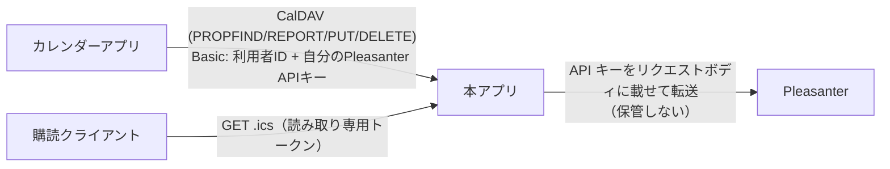
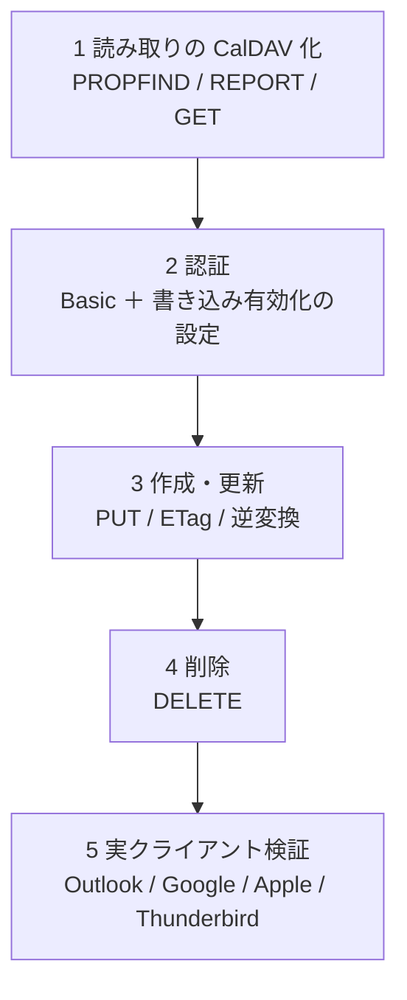

# CalDAV 書き込み 設計方針

カレンダーアプリから予定を作成・更新・削除し、Pleasanter のレコードへ反映するための設計方針。
**実装はこの文書の対象外**（別 Issue）。Issue #73。

> 状態: **設計（未実装）**。「確認が必要な点」に残した事項は実機で確かめてから実装する。

## 1. 決定事項（2026-10-15、利用者の回答）

| 項目 | 決定 |
| --- | --- |
| 認証と書き手 | **利用者ごとの Pleasanter API キー**を、カレンダーの資格情報（Basic 認証のパスワード）として受け取る |
| 操作の範囲 | **作成・更新・削除すべて** |
| 見せ方 | **フィード 1 つ ＝ カレンダー 1 つ**（ホーム探索は作らない） |
| 対応外の内容 | **繰り返し（RRULE 等）は拒否**。アラーム・参加者などの他の修飾は**無視して保存** |
| 競合 | **ETag で検出して 412** |

## 2. 全体像

- **読み取りの購読（`GET /feed/{token}.ics`）は今のまま。** 書き込みは**別の入口**（例: `/caldav/{フィード識別子}/`）を足す
- 1 フィードの**列の対応・既定の長さ・期間**は読み取りと同じ定義を使う。**書き込みで逆変換する**

## 3. 認証と規約 8 の整合

- 規約 8 は「**サーバが保持する資格情報**（フィードの API キー）を購読側へ渡さない」こと。
  書き込みでは、**利用者が自分の API キーを自分で入力する**ので、渡る方向が逆で規約には反しない
- **ただし次を必須とする**
    - 本アプリは書き込み用の API キーを**保管しない**。リクエストごとに受け取り、Pleasanter へ転送するだけ。ログ・例外・応答へ出さない
    - **TLS を前提**とする（Basic 認証は平文と同じ）。HTTP での書き込みは拒否する
    - Pleasanter の API キーはリクエストボディに載せる方式（`Context.cs`）。本アプリが代理で載せ替える
- **書き込みを許すフィードは、管理画面で明示的に有効化**する（既定は無効）。購読 URL のトークンでは書き込めない
- **書いた人は Pleasanter の更新者として残る**（利用者本人の API キーなので、権限・更新履歴・監査が Pleasanter 側で成立する）
- 認証失敗の連続は既存の共有レート制限（`SharedRateLimiter`）に載せる

## 4. CalDAV の最小実装（RFC 4791）

一次情報: RFC 4791（<https://www.rfc-editor.org/rfc/rfc4791.txt>、参照 2026-10-15）。
**クライアント互換のため必要な最小集合**に絞る。

- `OPTIONS`: `DAV: 1, calendar-access`（4.2 / 5.1.1）。**`calendar-auto-schedule` は広告しない**
  （RFC 6638 2 章。スケジューリングを持たないサーバは広告しなくてよい）
- `PROPFIND`（カレンダーのコレクションと各予定）: `resourcetype`（`collection` と `calendar`）、`getetag`、`supported-calendar-component-set`（`VEVENT` のみ）
- `REPORT`: **`calendar-query` と `calendar-multiget`**（RFC 4791 7.8 / 7.9。クライアントが使う）。
  `free-busy-query` は対象外とする（RFC は必須としているため、**未対応であることを制約として明記**する）
- `GET`: 1 件の `.ics`（読み取りと同じ変換）
- `PUT`: 作成は `If-None-Match: *`、更新は `If-Match`（5.3.2）
- `DELETE`: `If-Match` を尊重
- **`MKCALENDAR` は対応しない**（RFC 上は推奨止まり。カレンダー＝フィードは管理画面で作る）
- ホーム・プリンシパルの探索（`calendar-home-set` など）は作らない（決定 1 つ＝カレンダー 1 つ）。
  クライアントには**カレンダーの URL を直接**登録してもらう

## 5. 予定とレコードの対応

- **UID**: 読み取りで出している UID（レコードの識別子から決まる安定した値）を使う。
  **新規作成時は、クライアントが付けた UID をレコードへ保管**して再現できるようにする
  （保管先の列は未確定。確認が必要な点 1）
- **作成**: Pleasanter のレコード作成 API。API の回数に **1 回**数える
- **更新**: ETag が一致した場合だけ更新。API の回数に **1 回**
- **削除**: Pleasanter のレコード削除 API（ごみ箱の有無は未確認。確認が必要な点 2）
- **ETag**: レコードの**更新日時（`UpdatedTime`）または版**から作る。読み取りの `.ics` の ETag とは分けない
- **日時の逆変換**: 読み取りで使うタイムゾーンの扱い（アーキテクチャ方針 5 章）の**逆**。
  `TZID` 付き・UTC・終日（`VALUE=DATE`）を、API キーの利用者のタイムゾーンへ直して書く
- **複数日にまたがる終日**は読み取りと同じ規則で戻す（終了は排他的）

### 対応外の内容

- **繰り返し**（`RRULE` / `RDATE` / `EXRULE` / `EXDATE` / `RECURRENCE-ID`）→ **403**（RFC 4791 の `valid-calendar-object-resource` / `supported-calendar-component` 事前条件に準じ、
  応答本文へ理由を入れる）。**データを壊さないため。**
- `VALARM`・`ATTENDEE`・`ORGANIZER` など → **無視して保存**。次回の同期で、クライアント側から消える可能性があることを運用手順書で案内する
- `VTODO` / `VJOURNAL` → 403（`supported-calendar-component-set` が `VEVENT` のみ）

## 6. 競合（ETag）

- 更新・削除は `If-Match` 必須。**無いときは 428**（RFC 6585）
- 一致しないとき **412**（RFC 7232）。クライアントが再取得して利用者へ知らせる
- Pleasanter 側の整合: `IssueModel.cs` の更新は、`Timestamp` を渡すと
  **`UpdatedTime` が一致する場合だけ更新し、違えば `UpdateConflicts` を返す**
  （`_reference/Implem.Pleasanter/Implem.Pleasanter/Models/Issues/IssueModel.cs` 2146–2151 行、2026–2031 行。ソース上の確認）。
  **本アプリはこれに ETag を載せて渡し、Pleasanter の判定を最後の防壁にする**（本アプリ側の事前チェックだけでは、事前チェックと更新の間の競合を防げない）
- 実機での確認は未了（確認が必要な点 3）

## 7. 制約と注意

- **Pleasanter の API の回数**（`LimitPerSite`、サイトごと・1 日ごと）を、書き込みも消費する（実機検証結果 13 章）。
  書き込みが上限に当たったら **503 ＋ `Retry-After`**（日付が変わるまで）にし、カレンダーに再試行させる
- **読み取りキャッシュの無効化**: 書き込み成功後は、そのフィードの生成済み `.ics` を捨てる（既存の無効化の仕組みを使う）
- **書き込み可能な列は、列の対応で定義したものだけ**（題名・開始・終了・説明など）。それ以外の列は触らない（読み取りの対応と同じ定義）
- **権限**: Pleasanter 側の権限が不足すれば 403。**権限の判定は Pleasanter に任せ、本アプリで二重に判定しない**
- **サーバ側の資格情報（フィードの API キー）は書き込みに使わない**

## 8. 実装の段階（案）

各段階を 1 スライス（Issue・PR）とする。**段階 1 だけでもクライアントから読み取りの CalDAV として使える**。

## 9. 確認が必要な点（未確定）

1. **クライアントが付ける UID を保管する列**。`Description` の末尾か、専用の列（Pleasanter の分類・説明の項目）か。保管先が無いと、UID が変わって重複する
2. **削除がごみ箱か完全削除か**（Pleasanter のバージョンと設定による）。誤削除の救済に関わる
3. **更新 API で `Timestamp` を渡したときの競合の返り（HTTP ステータスとメッセージ）** を実機で確認する
4. **実クライアントの挙動**: Outlook / Google カレンダーは CalDAV の追加に制約がある（Google は CalDAV の自前サーバーを直接は追加しにくい）。対象クライアントを絞る必要があるか
5. **`calendar-query` の期間フィルタ**を、既存の期間（FeedRange）とどう両立させるか（クライアントの要求範囲と、フィードの表示期間の積）
6. 書き込み用の **URL とフィード識別子**（購読トークンとは別にするか）

## 10. 出典（参照 2026-10-15）

- RFC 4791 Calendaring Extensions to WebDAV (CalDAV): <https://www.rfc-editor.org/rfc/rfc4791.txt>
  （4.2 / 5.1.1 `OPTIONS`、5.3.2 `PUT`、5.3.2.1 事前条件、2 / 7 `REPORT`、MKCALENDAR は推奨）
- RFC 6638 Scheduling Extensions to CalDAV: <https://www.rfc-editor.org/rfc/rfc6638.txt>（2 章 `calendar-auto-schedule` の広告）
- 未確認で引用した規格（実装前に一次情報で再確認する）: RFC 4918（WebDAV）、RFC 5545（iCalendar）、RFC 6585（428）、RFC 7232（412・`If-Match`）
