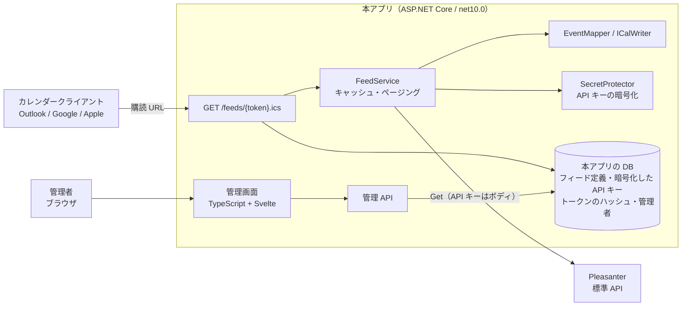
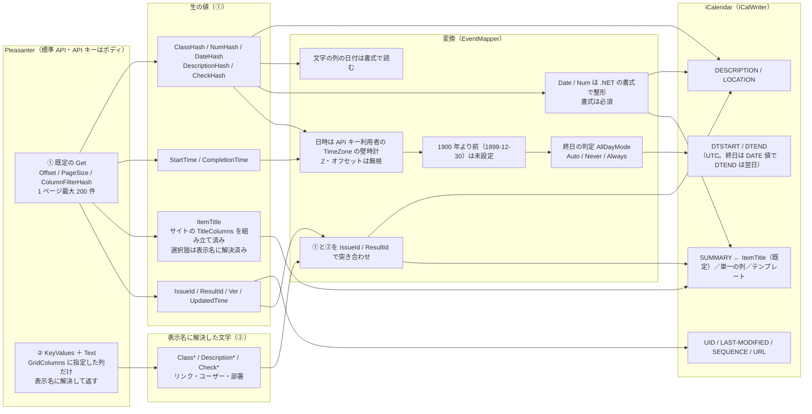
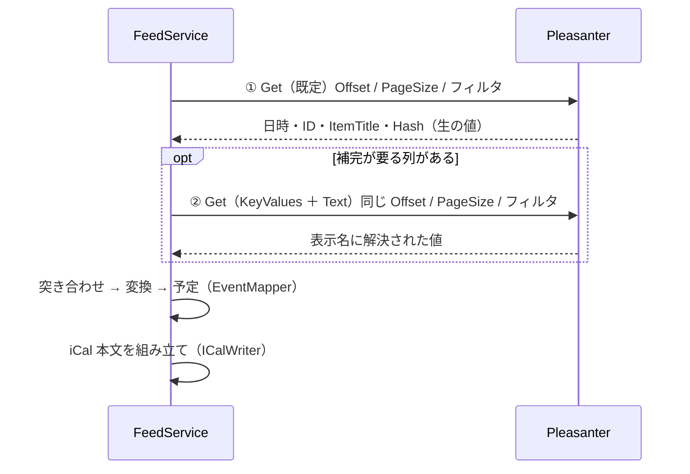

# アーキテクチャ方針

Pleasanter のレコードを iCalendar（RFC 5545）の**購読フィード**として公開するラッパーの構成方針。
構成・規約は兄弟リポジトリ Questionnaire に倣う。

> **状態。** 1〜6 章は決定済みで、**実装も追いついている**（フィードごとの API キー・4 種の RDBMS・管理画面・管理者の認証と管理・
> アプリケーション設定の画面編集・SAML / Pleasanter のログイン・失敗の通知・複数台）。
> 機能の一覧は [`機能一覧.md`](機能一覧.md)。未確定の事項は 8 章、残りの作業は 9 章。

## Pleasanter のログインでの管理画面（Issue #28）

任意の機能で、既定は無効。ブラウザの Pleasanter の cookie を本アプリのサーバが `POST /api/users/get`（利用者 ID `Own`）へ転送して本人を確かめ、
ログイン ID で本アプリの管理者へ結び付ける。**認可は本アプリの役割で行う**（所属は自動登録の条件にだけ使う）。**API キーはブラウザへ渡さない**
（cookie を転送する問い合わせに載せず、API キーの問い合わせに cookie を載せない）。同じホスト名での配置が前提。
セッションに Pleasanter のテナント・利用者・最後に確かめた時刻を持たせ（M0010）、管理 API の入口（`AdminSessionFilter`）が一定間隔で確かめ直す。
SAML と同じく、外部ログインのセッション情報は `SessionSso` にまとめ、2 要素の途中からログイン後へ引き継ぐ。

## SAML ログイン（Issue #28）

任意の機能で、既定は無効。ITfoxtec.Identity.Saml2（BSD-3-Clause）で SP を実装し、設定は他と同じく DB 保管の `AppSettings`（`CALENDARFEED_SAML_*`）。
**認可は本アプリの役割で行う**（IdP の属性から役割は引かない）。セッションは既存の `AdminSessions` を使い、SAML の NameID・SessionIndex を持たせて単一ログアウトに使う（M0009）。
ライブラリが見ない Destination は本アプリで確かめる。開始から応答までの相関（要求 ID・戻り先）は `ISecretProtector` で暗号化した cookie に持つ（複数台でも動く）。

## 1. 決定事項

| 項目 | 決定 | 決定日 |
| --- | --- | --- |
| 方向 | **読み取り専用。** Pleasanter → カレンダークライアントのみ | 2026-10-12 |
| プロトコル | HTTP GET で `.ics` を返す購読フィード。**CalDAV は対象外**（将来拡張を妨げない構成にはする） | 2026-10-12 |
| 購読側の認証 | **フィード単位の秘密トークン URL** | 2026-10-12 |
| Pleasanter の API キー | **フィードごとに 1 本。** DB へ暗号化して保管する（3 章） | 2026-10-12 |
| フィード定義の保管 | **本アプリの DB。** SQLite ＋ SQL Server / PostgreSQL / MySQL（Questionnaire と同じ 4 種） | 2026-10-12 |
| 管理画面 | **Svelte 製の簡易管理画面**（Questionnaire と同じ TypeScript + Vite + Svelte + SCSS） | 2026-10-12 |
| 多言語 | **Questionnaire に則る。** 画面は 7 言語（10 章） | 2026-10-12 |
| 管理者の認証・認可 | **Questionnaire に則る**（3 章） | 2026-10-12 |
| 複数インスタンス | 既定は単一プロセス。複数台は DB だけで成り立たせる（Redis は足さない。8 章 #5・Issue #49） | 2026-10-15 |
| ライセンス | **Questionnaire と同じデュアル**（AGPL-3.0-or-later OR 商用） | 2026-10-12 |
| Pleasanter との接続 | 標準 Web API（`Get`）。Pleasanter 本体は改造しない | 2026-10-12 |

## 2. 構成

| プロジェクト | 役割 |
| --- | --- |
| `Core` | iCal 生成（`ICalWriter`）、レコード→予定の変換（`EventMapper`）、フィード定義とトークン |
| `Pleasanter` | 標準 API クライアント（一覧取得のみ） |
| `Data` | フィード定義・管理者の保管（4 種の RDBMS）、マイグレーション |
| `Web` | 購読エンドポイント、管理 API、管理画面の配信、キャッシュ |
| `Frontend` | 管理画面（Svelte）。成果物は `Web/wwwroot` へ出す |

## 3. 認証と資格情報

### 購読側

- **購読 URL のトークンは 256 bit の乱数。** DB には SHA-256 だけを保管し、発行時に 1 度だけ見せる
- トークンは URL に載るため、次を押さえる
    - 不明・失効は**どれも同じ 404**（有効なトークンの推測材料を与えない）
    - `Referrer-Policy: no-referrer` / `X-Robots-Tag: noindex`
    - **アプリのログへ出さない。** `Microsoft.AspNetCore.Hosting.Diagnostics` を Warning に落とす。
      **リバースプロキシのアクセスログには URL が残る**（8 章 #6）
    - 漏えい時は**トークンの作り直し（旧トークンは即失効）**か、フィードの失効
- **購読者ごとの権限分離はできない。** トークンを知る者は、そのフィードに見せると決めた範囲を全部見られる

### Pleasanter の API キー（フィードごと）

- **見える範囲は API キーの利用者の権限で決まる。** フィードごとにキーを持たせ、
  **そのフィードに見せてよい範囲だけ**を権限として持つ利用者のキーを使うことで、見せる範囲を分離する
- **API キーは DB へ暗号化して置く。ブラウザへは返さない**（管理 API も管理画面も、登録後は値を返さない。
  「登録済み」と末尾の数文字だけを見せる）
- **実装済み**（Issue #19）。`ISecretProtector` / `SecretProtector`（Core）、`Feeds.ApiKeyCipher` / `ApiKeyHint` / `ApiKeyUserTimeZoneId` / `Language`（`M0002`）、
  管理 API の `apiKey`（作成時）と `PUT /admin/api/feeds/{id}/apikey`（差し替え）
- **暗号化は Questionnaire の `SecretProtector` と同じ方式**（AES-GCM、運用者が持つ 256 bit の鍵を設定から受け取る）。
  **Data Protection の鍵束は使わない。** App Service では鍵の保存先が既定で一時領域になり、
  再起動で鍵を失うと保管した API キーが全部使えなくなるため
  （Questionnaire `Web/Services/SecretProtector.cs` の注記）。
  鍵を失ったときは API キーを登録し直す（復旧手順は運用手順書へ）
- 設定名は `CALENDARFEED_SECRET_KEY`（`dotnet run -- --generate-secret-key` で作れる。**未設定でもアプリは起動するが、API キーの保管・使用は設定名を挙げて止まる**）
- **暗号文はフィード ID に束縛する**（AES-GCM の追加認証データ `calendarfeed:apikey:{ID}`）。別のフィードの行へ暗号文を差し替えても復号できず、
  他のフィードの API キーを自分のフィードで使わせることができない
- **全フィード共通の既定の API キー**（`Pleasanter.json` の `ApiKey`）は**任意**で残してある。フィード側が未登録のときだけ使う。
  どちらも無いフィードは作れない（400）。通常はフィードごとに登録する
- 取得のたびにサーバ内だけで復号し、**ログ・例外・応答へ出さない**（実機のアプリで DB とログに平文が無いことを確認）
- **鍵を失う・変えると復号できず、フィードは 502 になる**（API キーを登録し直す）。**鍵は環境変数（`CALENDARFEED_SECRET_KEY`）で保持する**
  （決定 2026-10-12。**Questionnaire と同じ**: Questionnaire は秘密の鍵を `QUESTIONNAIRE_SECRET_KEY` の環境変数で保持する。
  デプロイ先の秘密の保管先――Azure App Service のアプリケーション設定・Key Vault の参照など――へ置く）。ファイルへ直書きせず、コンテナやディスクが作り直されても残る場所に置けば、失う事故は避けられる。
  手順は [`導入-更新運用手順書.md`](導入-更新運用手順書.md) 8 章
- **API キーの失効・権限変更は Pleasanter 側で行う。** 失効したキーは 401 になり、フィードは 502 を返す。
  管理画面へ「最後の取得結果」を出して気づけるようにする（8 章 #7）

### 管理画面

**認証・認可は Questionnaire の方式に則る**（2026-10-12 決定。Questionnaire `_documents/アーキテクチャ方針.md` 11 章）。

| | 決定 |
| --- | --- |
| 認証 | **本アプリに独自のログイン（ログイン ID ＋ パスワード ＋ 2 要素）を持つ。** 任意で SAML 2.0、Pleasanter のログインでも入れる（どちらも既定は無効） |
| 認可 | **本アプリの DB のロールだけで判定する**（SAML・Pleasanter から来た人も同じ。Pleasanter のグループ・組織では認可しない） |
| 管理者アカウント | 本アプリの DB。パスワードは**ハッシュのみ**（PBKDF2）。**資格情報を Pleasanter のサイトへ置かない** |
| セッション | **サーバ側のセッションストア。** 既定は本アプリの DB、任意で Redis。cookie は Data Protection で保護したセッション ID だけを持ち、`Secure` / `HttpOnly` / `SameSite` |
| 棚卸し | Pleasanter のユーザ・グループとは連動しない。**最終ログイン日時を持たせ、棚卸しを運用手順に含める** |

- **Pleasanter のログインで入る方式は、ブラウザの cookie を本アプリのサーバが `POST /api/users/get` へ転送して本人を確かめる。**
  cookie はホスト名単位でしか届かないため、**本アプリを Pleasanter と同じホスト名のサブパスへ置く**前提が付く
  （Questionnaire `Pleasanter-SSO-運用手順書.md` / `サブパス配置-運用手順書.md`）
- **購読エンドポイントはこの認証の外**（トークン URL だけで読める）。管理画面の入口と混ぜない
- **実装済み（第 1 段。Issue #24）。** Questionnaire の方式に則る:
    - **2 段階で通す**: `POST /admin/api/login`（パスワード）→ `Pending`（5 分・**何も操作させない**）→ `login/totp` か `login/recovery` → `Session`（8 時間）。
      2 要素が要らない構成では `login` で `Session` になる。管理 API（`/admin/api/feeds`）は `Session` だけを通す
    - **パスワードは PBKDF2-HMAC-SHA512・210,000 回**（書式 `v1$反復$塩$ハッシュ`。反復回数を上げても次のログインで移行できる）。条件は `Security.json`
    - **利用者が居なくても照合する／どの段階で外れたかを外へ伝えない**（居ない・無効・締め出し・違うを同じ応答に）
    - **TOTP は同じ時間枠の数字を二度通さない**（`TotpLastTimeStep` を条件に含めた UPDATE の件数で判断）。**数字の総当たりも締め出しに数える**。
      共有鍵は `SecretProtector` で暗号化（利用者 ID に束縛）。**復旧コードは 10 本・使い切り・登録し直すと消える**
    - **締め出しは DB に持つ**（5 回・15 分。恒久的には締め出さない）。ログインの試行だけ別枠のレート制限（IP ごと 5 分に 10 回）
    - **cookie は推測できない 256 bit のセッション ID だけ**（DB には SHA-256 だけ）。`HttpOnly` / `SameSite=Strict` / `Secure`（HTTPS、または公開 URL が HTTPS のとき）。
      Data Protection の鍵束は要らない。ログアウト・パスワード変更（他端末）・締め出し（途中のセッション）で**その場で失効**
    - **CSRF**: 状態を変える要求は `Sec-Fetch-Site` と `Origin` を確かめる（同じサイトのものだけ）
    - **最初の管理者**は、管理者が 1 人も居ないときだけ `POST /admin/api/setup` で作れる。**排他は `AdminSetup` 表の主キー**
      （「居なければ INSERT」の 1 文は PostgreSQL の既定の分離水準で同時に来た複数が通ってしまう。実機で確認）。
      **公開する前に作る**（空の状態を放置すると、最初に来た人が管理者になる）
    - **暫定の管理キー（`CALENDARFEED_ADMIN_APIKEY`）は廃止した**
    - 役割は 5 つ（`AdminUsers.Role` に名前で入る。Issue #26）。**認可は本アプリの DB のロールだけで判定する**
- **管理者の管理（Issue #26）**: **Questionnaire に則る。** 権限の集合を役割へ割り当てる（`Administrator` / `FeedAdministrator` / `UserAdministrator` / `Editor` / `Auditor`）。
  招待は**期限 48 時間・1 回だけ**で、トークンは SHA-256 だけ保管し、受け取る人が自分でパスワードを決める。**本人へメールで直接送り**（Mail プロジェクト＝SMTP / Amazon SES / Azure Communication Services、
  暗号化した送信待ち `MailOutbox`＋アプリ内のワーカー）、送れない構成では画面の URL を手で渡す。最後の有効な Administrator は、1 文の UPDATE と行のロックで守る
- **アプリケーション設定（Issue #40）**: **管理画面から編集できる**（Questionnaire に則る）。DB の `AppSettings` 表へ保管し、**外部設定（固定）＞ DB ＞ 既定値**。秘密は暗号化して保管し画面へ返さない。
  使う側は `RuntimeSettings.Current` を使うたびに読み、保存はその台へ即反映・他の台へは 30 秒以内。起動に要る値（DB・秘密の鍵・転送ヘッダの信頼ネットワーク・パスワード条件の正規表現）は、ファイル／環境変数のまま
- **後続（別の Issue）**: SAML、Pleasanter SSO、パスワード条件の正規表現、管理画面（Svelte）

## 4. 予定への変換

| iCal | 元 | 既定 |
| --- | --- | --- |
| `SUMMARY` | `SummaryColumn` | `ItemTitle`（Pleasanter がサイト設定のタイトルで組み上げた表示用タイトル。**実機の応答で返ることを確認済み**（2026-10-12、利用者の報告）。無ければ `Title`。空なら「(無題)」） |
| `DTSTART` | `StartColumn` | `StartTime` |
| `DTEND` | `EndColumn` | `CompletionTime`。無い・開始以前なら `DefaultDurationMinutes`（60 分）を補う |
| `DESCRIPTION` | `DescriptionColumn` | `Body` |
| `LOCATION` | `LocationColumn` | なし |
| `UID` | `{SiteId}-{レコード ID}@{フィード ID}.calendarfeed` | レコードごとに不変 |
| `LAST-MODIFIED` / `SEQUENCE` | `UpdatedTime` / `Ver - 1` | |
| `URL` | `PublicBaseUrl` + `/items/{レコード ID}` | 設定時のみ |

- **型付きの列**（`ClassA` / `DateA` / `DescriptionA` / `NumA` / `CheckA`。標準は接尾辞 `A`〜`Z`、項目拡張は `001`〜`100`）は
  レコードの `ClassHash` などから読む。開始・終了には `StartTime` / `CompletionTime` / `Date[A-Z]` / `Date\d{3}` を
  指定できる（`FeedMapping.Validate()`）
    - **選択肢・リンク・ユーザーの列は、既定の応答では生の値のまま**。件名のテンプレート・説明・場所では、**Pleasanter に表示名へ解決させた文字**を使う（4 章の図。実機検証結果 7 章）
    - **開始・終了に文字の列（`Class*` / `Description*` / `Title` / `Body`）を指定するときは、日付の書式（`StartFormat` / `EndFormat`。
      .NET のカスタム書式文字列を `ParseExact` で読む）が必須。** 日付の列（`StartTime` / `Date*` など）に書式は付けない。
      保存時に、整形して同じ書式で読み戻せることを確かめる（`ddd` のように読み戻せない書式は 400）
    - **日付・数値の列を文字にするときは、.NET のカスタム書式文字列が必須**（`Formats` か `{DateA:yyyy/MM/dd}`）。インバリアントカルチャで整形する
- **時間指定の予定は UTC（`Z` 付き）で出す。** VTIMEZONE を持たずに済む
- **終日**は `AllDayMode` で決める（フィード単位）: `Auto`（既定。開始が 0:00 で終了が無いか 0:00 なら終日）／`Never`（常に時間指定）／`Always`（常に終日）。
  `DTEND` は終了日の翌日（RFC 5545 は排他）。完了日が日付のみの入力形式のとき、Pleasanter は内部に「表示 + 1 日」で保存し API は表示値を返すので、API 上の終了日は包含で、この変換が合う
- **値は必ず TEXT エスケープし、75 オクテットで折り返す。** 本文の改行から別プロパティを差し込ませない
- 開始が未設定のレコードは出さない
- 取得は `Offset` / `PageSize` で全ページを辿る。上限は 5000 件（`Feed:MaxEvents`）
- **Pleasanter の API 回数制限を守るため、生成した `.ics` を 300 秒キャッシュする**（`Feed:CacheSeconds`）。
  `REFRESH-INTERVAL` / `X-PUBLISHED-TTL` も同じ値で返す。ETag で 304 に対応する。
  **キャッシュはフィード ID 単位。** API キーを変えたら破棄する

### データの取得元と変換の流れ

**実線が実装済み**（#5・#14 を含む）。根拠は [`実機検証結果.md`](実機検証結果.md)（Pleasanter 1.5.8.1）。

| 出力 | 取得元 | 変換 | 状態 |
| --- | --- | --- | --- |
| `SUMMARY`（既定） | ①の `ItemTitle` | なし（Pleasanter が組み立て・解決済み。空なら「(無題)」） | 実装済み |
| `SUMMARY`（任意の組み立て） | ①の各列 ＋ ②の表示名 | テンプレート `{ClassA}：{Title}（{DateA:yyyy/MM/dd}）`。`Date` / `Num` は書式で整形 | 実装済み |
| `DTSTART` / `DTEND` | ①の `StartTime` / `CompletionTime` / `DateX` | 壁時計 → UTC。終日は日付のみ。終了が無ければ既定の長さを補う | 実装済み |
| `DTSTART` / `DTEND`（文字の列） | ①の `Class*` / `Description*` / `Title` / `Body` | 書式で読む（`ParseExact`。`StartFormat` / `EndFormat` 必須）。空・読めない開始と、空でないのに読めない終了は予定を出さない | 実装済み |
| `DESCRIPTION` / `LOCATION` | ①の `Body` / 各列 ＋ ②の表示名 | 選択肢・リンク・ユーザー・状況は表示名、`Date` / `Num` は書式（`Formats`）で整形、他は生の値 | 実装済み |
| `UID` / `SEQUENCE` / `LAST-MODIFIED` | ①の ID・`Ver`・`UpdatedTime` | `UID` は `{SiteId}-{ID}@{フィード ID}` | 実装済み |

- **日時は必ず①から取る。** ②の `Text` は日付だけでロケール依存、`Value` は DB の値（サーバの OS 時刻）で使えない
- **②を呼ぶのは、補完が要る列があるときだけ**（`Class*` / `Description*` / `Check*` とリンク・ユーザー・部署の列）。
  `Date` / `Num` は①の生の値を本アプリが整形するので、②は要らない
- **補完は API キー利用者の権限の範囲でしか効かない**（列のアクセス制御・リンク先サイトの読み取り権限）。
  フィードに出すサイトと、参照するリンク先サイトの読み取り権限を、API キーの利用者に持たせる
- 数値は Pleasanter が列の小数桁（既定 0）に丸めて保存する。小数を出すなら、Pleasanter のサイト設定で小数桁を増やす

## 5. 日時の扱い

Questionnaire の実機検証では、Pleasanter 1.5.7.0 は**日時を API キーを持つ利用者のタイムゾーンで返す**。
日時はその利用者のタイムゾーンの壁時計として読む（末尾の `Z` やオフセットは無視する）。
未設定の日付は `1899-12-30` で返るため、1900 年より前は未設定とみなす。

> **対象版（Pleasanter 1.5.8.1）の実機で確認済み**（2026-10-12。[`実機検証結果.md`](実機検証結果.md) 1・2 章。
> Questionnaire の 1.5.7.0 での結果と同じ）。

- **`Z` は飾り。** 利用者が `UTC` のときだけ付き、時刻は常に利用者のタイムゾーンの壁時計
- **日付だけのレコードを 0:00 に読むには、API キー利用者の `TimeZone` を運用の標準タイムゾーン（日本なら `Tokyo Standard Time`）にする。**
  `UTC` の利用者で読むと別の時刻に見え、終日の自動判定が効かない
- 期限付きテーブルの `StartTime` / `CompletionTime` は未設定にならない（既定は作成日と 7 日後）。未設定が `1899-12-30` で返るのは `DateX` の列

**`ApiKeyUserTimeZoneId` は API キーの利用者の `TimeZone` と一致させる。** API キーがフィードごとになるため、タイムゾーンも「フィードごと」の設定になる（利用者ごとに違い得る）。
フィード定義へ `ApiKeyUserTimeZoneId` を持たせる（足場はアプリ全体の設定。9 章で移す）。
**運用開始後に変えると、そのフィードの全予定の時刻がずれる。**

## 6. データとマイグレーション

- アクセスは **Dapper ＋ FluentMigrator**（Questionnaire と同じ。いずれも Apache-2.0）。
  接続先は `SQLite` / `SqlServer` / `PostgreSql` / `MySql` を設定で選ぶ
- 3 RDBMS 差（型・`LIMIT` と `TOP`・真偽値・`INSERT` の取得）は **`SqlDialect` に閉じ込める**
  （Questionnaire の `Data/SqlDialect*.cs` が構造の参考）。コードは取り込まず、**同じ組織の成果物であっても
  流用するときは依存とライセンスを確認する**（`CLAUDE.md`）
- マイグレーションは起動時に自動で当てる。無効にして手で当てることもできる（Questionnaire と同じ。`CALENDARFEED_DB_AUTOMIGRATE=false`）。
  **複数インスタンスを同時に起動しても、当てるのは 1 台だけ**（DB の排他ロック。`MigrationLock`。SQL Server は `sp_getapplock`、PostgreSQL は `pg_advisory_lock`、MySQL は `GET_LOCK`。SQLite はロックしない）
- **4 種の RDBMS で通じる型だけを使う**（ID は文字列、日時は ISO 8601 の文字列、真偽は 0/1 の整数）
- ⚠️ **MySQL は FluentMigrator の `AsString`（NVARCHAR）が utf8mb3 になる**ため、DB の既定が utf8mb4 でも絵文字が入らない
  （実機で確認）。マイグレーションで表ごと `utf8mb4` ＋ 大文字小文字を区別する照合順序へ直している
- SQL Server は**データベースを作らない**（接続前に用意する）。接続文字列の `Encrypt=False` は無視して暗号化する
- **Pleasanter の DB とは別に、本アプリ専用の DB を作る**

| 表 | 主な列 |
| --- | --- |
| `Feeds` | `Id` / `Name` / `SiteId` / `MappingJson` / `FiltersJson` / `ApiKeyCipher`（暗号文） / `ApiKeyHint`（末尾 4 文字） / `ApiKeyUserTimeZoneId` / `Language` / `TokenHash`（一意） / `CreatedAt` / `IsRevoked` |
| `AdminUsers` / `AdminSessions` / `AdminRecoveryCodes` / `AdminSetup` | 管理者の認証情報・セッション・復旧コード・最初の管理者の印。`AdminSessions` は SAML の鍵（`SamlNameId`・`SamlSessionIndex`。M0009）と Pleasanter のログインの再検証の値（`PleasanterTenantId`・`PleasanterUserId`・`PleasanterVerifiedAt`。M0010）を持つ |
| `AdminInvitations` / `MailOutbox` | 管理者の招待（トークンの SHA-256 だけ）・メールの送信待ち（宛先・件名・本文を 1 列に暗号化。送れたら消す） |
| `AppSettings` | 管理画面から編集するアプリケーション設定（秘密は暗号化）。SAML・Pleasanter のログインの設定も、ここに置く（別の表は作らない） |
| `AuditLogs` | 監査ログ（保存期間で掃除する） |
| `RateLimits` | 複数台で共有するレート制限の数え（固定窓。M0012） |
| `Feeds`（追加の列） | 最後の取得結果（M0008）と、連続の失敗の回数・通知の印（`ConsecutiveFailures`・`FailureNotifiedAt`。M0011） |

## 7. 依存

| 名称 | ライセンス | 用途 |
| --- | --- | --- |
| Microsoft.Data.Sqlite 10.0.12 | MIT | SQLite |
| Dapper / FluentMigrator 8.0.1 | Apache-2.0 | データアクセス・マイグレーション（Questionnaire と同じ版を `NOTICE` へ追記して導入） |
| Microsoft.Data.SqlClient / Npgsql / MySqlConnector | MIT / PostgreSQL License / MIT | 各 RDBMS（同上） |
| Svelte / Vite / TypeScript ほか | MIT / MIT / Apache-2.0 | 管理画面 |
| ITfoxtec.Identity.Saml2 | BSD-3-Clause | SAML 2.0 の SP（Questionnaire と同じ版） |
| Otp.NET / MailKit / AWSSDK.SimpleEmailV2 / Azure.Communication.Email ほか | MIT / Apache-2.0 | 2 要素（TOTP）・メールの送信（Questionnaire と同じ版） |

**依存の一覧と版・ライセンス・参照日は [`NOTICE`](../NOTICE) が単一の参照元**（ここへ複製しない）。

iCal の生成は自前（RFC 5545 の必要部分のみ）。**Pleasanter 本体（AGPL v3）のコードは取り込まない。**

## 8. 未確定の事項

| # | 論点 | 現状・候補 |
| --- | --- | --- |
| 1 | 期間の絞り込み | **決定・実装済み**（Issue #67）。フィードごとに `PastDays`・`FutureDays`（今日から何日まで。**null は無制限＝開区間**。既定は過去 365 日・未来は無制限）。**期間と重なる予定を出す**。Pleasanter へは日付の列の粗い絞り込み（書式は実機で確認。実機検証結果 12 章）、正確な判定は取得した後。`Feeds.RangePastDays`・`RangeFutureDays`（M0013） |
| 2 | 管理者認証の実装順 | **完了**（パスワード ＋ TOTP → 監査ログ・棚卸し → 役割と招待 → SAML・Pleasanter のログイン。[`機能一覧.md`](機能一覧.md)） |
| 3 | `CompletionTime` の意味 | **実機で確認済み**（[`実機検証結果.md`](実機検証結果.md) 4 章）。日付のみの形式では API は表示値を返し、終了日は包含 |
| 4 | API 回数制限への当たり方 | **確認済み・対応済み**（実機検証結果 13 章。Issue #69・#71）。サイトごと・1 日ごと。超えると HTTP 429。**429 は専用の失敗（`RateLimited`）として扱い、購読 URL は `503`＋`Retry-After`（API キー利用者のタイムゾーンで日付が変わるまで）を返す。** 管理画面の取得結果と失敗の通知のメールに、上限に達したことと対処を出す。見積もり: 1 フィード 1 日あたり最大 `86400 ÷ キャッシュ秒数 × 1〜2` 回（運用手順書） |
| 5 | 複数インスタンス | **既定は単一プロセス。** 複数台は **DB だけで成り立つ**（Redis は足さない。Issue #49）: セッション・設定・アウトボックス・通知の印・レート制限の数え（ログインと Pleasanter のログインの確認。`RateLimits` 表）・マイグレーションのロックを DB に置く。`.ics` のキャッシュと購読 URL のレート制限だけ台ごと。前提は運用手順書の「複数台での運用」 |
| 6 | プロキシのアクセスログ | **決定（2026-10-15）: 受け入れる＋手順書で案内。** Questionnaire は再編集リンクのトークンを URL の断片（`#` の後ろ。サーバへ送られない）に置いて避けているが、**購読 URL は、カレンダークライアントが URL を丸ごと送るので、この方法は使えない**。Questionnaire が再編集リンクで「対策せずに受け入れる」と決めた（2026-09-14）のと同じ整理。**ログへ残る恐れは受け入れ**、緩和は、トークンの作り直し・フィードの失効（実装済み）と、プロキシのログのマスク設定（運用手順書 7 章）。本アプリ自身のログには、トークンを出さない（`Microsoft.AspNetCore.Hosting.Diagnostics` を Warning にしてある） |
| 7 | 取得失敗の見せ方 | **決定・実装済み。** 管理画面に「最後の取得結果」と連続の失敗の回数を出し、**連続の失敗が閾値に届いたらフィードを編集できる管理者へメールで知らせる**（回復も 1 通。既定は無効。Issue #48。保存先は `Feeds` の列） |
| 8 | CalDAV（書き込み） | 対象外。必要になったら別途設計 |
| 9 | 任意の組み立てタイトルと表示テキストの解決 | **実装済み**（Issue #5）。実機検証結果 7 章。**解決は API キーの利用者の権限の範囲でしか効かない**（リンク先サイトの読み取り権限・列のアクセス制御）。リンク列の解決は未確認（選択肢・ユーザー・状況は確認済み） |

## 9. 足場から決定へ追いつかせる作業

**1〜6 は完了**（6 のライセンス一式は Issue #63。`CLA.md` は草案で法務の確認待ち、CLA の自動チェックは未整備）。 実装の順序（各項は 1 PR 程度の粒度）だった。

1. **`Data` を Dapper ＋ FluentMigrator ＋ `SqlDialect` へ移し、4 種の RDBMS を通す**（`SqliteFeedStore` を置き換える）
2. **API キーのフィード単位化。** `SecretProtector` 相当、`Feeds.ApiKeyCipher` / `ApiKeyUserTimeZoneId`、
   `PleasanterClient` を呼び出しごとに API キーを受ける形へ
3. **管理者認証**（3 章。**第 1 段（パスワード＋TOTP＋セッション）は実装済み**。後続は 3 章の末尾）
4. **管理画面（Svelte）**: フィードの一覧・作成・トークン再発行・失効・API キー登録・最後の取得結果
5. **運用手順書**（導入・更新・鍵の失い方・プロキシのログ）と、4 種の RDBMS・実機 Pleasanter への結合テスト
6. **ライセンス一式**（`LICENSE` / `LICENSE-COMMERCIAL.md` / `LICENSING.md` / `CLA.md` / `CONTRIBUTING.md`）の整備

## 10. 多言語対応

**Questionnaire の `多言語対応方針.md` に則る**（2026-10-12 決定）。本アプリが持つ文字列は
**管理画面の文言とサーバが返す文言だけ**で、購読フィード（`.ics`）には画面が無い。

| 項目 | 決定 |
| --- | --- |
| 対応言語 | 7 つ: `en` / `zh` / `ja` / `de` / `ko` / `es` / `vi`（本アプリ内のコード。地域は見ない） |
| 落とし先 | 選択した言語 → `en` → `ja`。**対応外の言語コードは例外にせず「指定なし」として扱う** |
| 管理画面の言語 | `AdminUsers.Language` → `navigator.languages` → `ja` |
| サーバが返す文言 | **実装済み**（Issue #58）。`Accept-Language` で決める（管理画面が、画面で選んだ言語を明示して送る）。`ServerMessages`（7 言語。`Core/Localization`）と `RequestLanguage`・`ApiError`（`Web/Localization`）。**`Accept-Language` が無い・対応外の要求は `en`**（`en` → `ja` の順で落ちる）。失敗の理由が漏れない方針は変えない（ログインの失敗は、言語だけが変わる）。**動的な検証メッセージも対応済み**（Issue #61）: 設定の値（`AppSettingDefinitions`）・SAML と Pleasanter のログインの設定・フィードの列の対応（`FeedMapping`・件名テンプレート）。**例外が文言の鍵と埋め込みの値を持ち**（`SettingException`・`AppSettingValidationException`・`TemplateFormatException`。`Message` は日本語でログ用）、管理 API が要求の言語で返す。**設定は項目名ではなく設定の鍵（環境変数と同じ名前）で示す**。起動時の設定の検証（`MailOptions`・`PasswordPolicies`）は対象外 |
| 文言カタログ | フロントエンドは 7 言語の鍵のカタログ、サーバは `ServerMessages`。**鍵の抜けは、フロントエンドは `messages.test.ts`、サーバは `ServerMessagesTests`（7 言語・埋め込みの数・かなの混入）で検査する** |
| Pleasanter の言語 | **Pleasanter との境界で言語を渡す機会は無い**（`Get` のみ）。`vi` ↔ `vn` の読み替えは持ち込まない |

- **予定の中身はデータであって文言ではない。** Pleasanter のレコードの値を翻訳せずにそのまま出す
- **例外: 件名が空のときの仮の件名「(無題)」。** `.ics` は購読者の言語を知らないので、
  **フィード定義に持たせた言語**（既定 `ja`）で決める。`Feeds` に `Language` 列を足す（6 章。9 章 2 の作業に含める）
- コードの識別子・ログ・コマンドラインの出力は `.github/copilot-instructions.md` の言語規約に従う
  （コメント・ログ・画面・ドキュメントは日本語、コンソールへ出す文字列だけ英語）

## 11. 設定ファイル

**Pleasanter 本体・Questionnaire と同じく `App_Data/Parameters/*.json` に置く**（Questionnaire `アーキテクチャ方針.md` 12 章）。
書き方・環境変数との対応・上書きの優先順位は [`App_Data/Parameters/README.md`](../src/VehicleVision.PleasanterTools.CalendarFeed.Web/App_Data/Parameters/README.md)。

- 優先順位は `{名前}.local.json` ＞ 環境変数 ＞ `{名前}.json`。**読み込みは `ParameterFiles` の 1 か所**
- ここに置くのは**アプリの動作設定**（接続先・タイムゾーン・キャッシュ）。**フィードごとの設定は本アプリの DB へ保存する**（6 章）
- **API キー・管理キー・接続文字列の実値はコミットしない。** 起動時に、読んだ置き場と見つかったファイルをログへ出す
- 設定名は `CALENDARFEED_*`（環境変数と同じ名前。`AppSettings` に 1 か所で定義）
