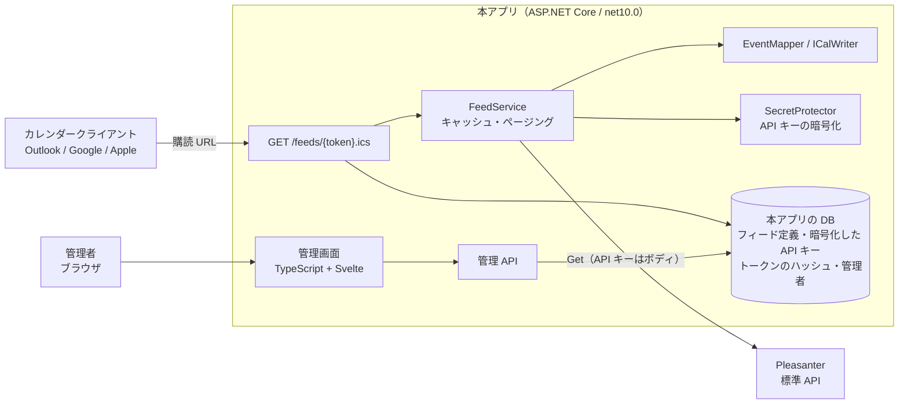

# アーキテクチャ方針

Pleasanter のレコードを iCalendar（RFC 5545）の**購読フィード**として公開するラッパーの構成方針。
構成・規約は兄弟リポジトリ Questionnaire に倣う。

> **状態。** 1〜6 章は決定済み。**足場の実装（v0.1.0 相当）は、4 章の一部（全フィード共通 API キー・
> SQLite のみ・管理 API のみ）が決定に追いついていない。** 追いつかせる作業は 9 章。
> 未確定の事項は 8 章。

## 1. 決定事項

| 項目 | 決定 | 決定日 |
| --- | --- | --- |
| 方向 | **読み取り専用。** Pleasanter → カレンダークライアントのみ | 2026-10-12 |
| プロトコル | HTTP GET で `.ics` を返す購読フィード。**CalDAV は対象外**（将来拡張を妨げない構成にはする） | 2026-10-12 |
| 購読側の認証 | **フィード単位の秘密トークン URL** | 2026-10-12 |
| Pleasanter の API キー | **フィードごとに 1 本。** DB へ暗号化して保管する（3 章） | 2026-10-12 |
| フィード定義の保管 | **本アプリの DB。** SQLite ＋ SQL Server / PostgreSQL / MySQL（Questionnaire と同じ 4 種） | 2026-10-12 |
| 管理画面 | **Svelte 製の簡易管理画面**（Questionnaire と同じ TypeScript + Vite + Svelte + SCSS） | 2026-10-12 |
| 多言語 | **Questionnaire に則る。** 画面は 7 言語（10 章） | 2026-10-12 |
| 管理者の認証・認可 | **Questionnaire に則る**（3 章） | 2026-10-12 |
| 複数インスタンス | **Questionnaire に則る。** 既定は単一プロセス、Redis は選択式（8 章 #5） | 2026-10-12 |
| ライセンス | **Questionnaire と同じデュアル**（AGPL-3.0-or-later OR 商用） | 2026-10-12 |
| Pleasanter との接続 | 標準 Web API（`Get`）。Pleasanter 本体は改造しない | 2026-10-12 |

## 2. 構成

| プロジェクト | 役割 |
| --- | --- |
| `Core` | iCal 生成（`ICalWriter`）、レコード→予定の変換（`EventMapper`）、フィード定義とトークン |
| `Pleasanter` | 標準 API クライアント（一覧取得のみ） |
| `Data` | フィード定義・管理者の保管（4 種の RDBMS）、マイグレーション |
| `Web` | 購読エンドポイント、管理 API、管理画面の配信、キャッシュ |
| `Frontend` | 管理画面（Svelte）。成果物は `Web/wwwroot` へ出す |

## 3. 認証と資格情報

### 購読側

- **購読 URL のトークンは 256 bit の乱数。** DB には SHA-256 だけを保管し、発行時に 1 度だけ見せる
- トークンは URL に載るため、次を押さえる
    - 不明・失効は**どれも同じ 404**（有効なトークンの推測材料を与えない）
    - `Referrer-Policy: no-referrer` / `X-Robots-Tag: noindex`
    - **アプリのログへ出さない。** `Microsoft.AspNetCore.Hosting.Diagnostics` を Warning に落とす。
      **リバースプロキシのアクセスログには URL が残る**（8 章 #6）
    - 漏えい時は**トークンの作り直し（旧トークンは即失効）**か、フィードの失効
- **購読者ごとの権限分離はできない。** トークンを知る者は、そのフィードに見せると決めた範囲を全部見られる

### Pleasanter の API キー（フィードごと）

- **見える範囲は API キーの利用者の権限で決まる。** フィードごとにキーを持たせ、
  **そのフィードに見せてよい範囲だけ**を権限として持つ利用者のキーを使うことで、見せる範囲を分離する
- **API キーは DB へ暗号化して置く。ブラウザへは返さない**（管理 API も管理画面も、登録後は値を返さない。
  「登録済み」と末尾の数文字だけを見せる）
- **暗号化は Questionnaire の `SecretProtector` と同じ方式**（AES-GCM、運用者が持つ 256 bit の鍵を設定から受け取る）。
  **Data Protection の鍵束は使わない。** App Service では鍵の保存先が既定で一時領域になり、
  再起動で鍵を失うと保管した API キーが全部使えなくなるため
  （Questionnaire `Web/Services/SecretProtector.cs` の注記）。
  鍵を失ったときは API キーを登録し直す（復旧手順は運用手順書へ）
- 設定名は `CALENDARFEED_SECRET_KEY`（必須。`--generate-secret-key` で作れる形にする）
- **API キーの失効・権限変更は Pleasanter 側で行う。** 失効したキーは 401 になり、フィードは 502 を返す。
  管理画面へ「最後の取得結果」を出して気づけるようにする（8 章 #7）

### 管理画面

**認証・認可は Questionnaire の方式に則る**（2026-10-12 決定。Questionnaire `_documents/アーキテクチャ方針.md` 11 章）。

| | 決定 |
| --- | --- |
| 認証 | **本アプリに独自のログイン（ログイン ID ＋ パスワード ＋ 2 要素）を持つ。** 任意で SAML 2.0、Pleasanter のログインでも入れる（どちらも既定は無効） |
| 認可 | **本アプリの DB のロールだけで判定する**（SAML・Pleasanter から来た人も同じ。Pleasanter のグループ・組織では認可しない） |
| 管理者アカウント | 本アプリの DB。パスワードは**ハッシュのみ**（PBKDF2）。**資格情報を Pleasanter のサイトへ置かない** |
| セッション | **サーバ側のセッションストア。** 既定は本アプリの DB、任意で Redis。cookie は Data Protection で保護したセッション ID だけを持ち、`Secure` / `HttpOnly` / `SameSite` |
| 棚卸し | Pleasanter のユーザ・グループとは連動しない。**最終ログイン日時を持たせ、棚卸しを運用手順に含める** |

- **Pleasanter のログインで入る方式は、ブラウザの cookie を本アプリのサーバが `POST /api/users/get` へ転送して本人を確かめる。**
  cookie はホスト名単位でしか届かないため、**本アプリを Pleasanter と同じホスト名のサブパスへ置く**前提が付く
  （Questionnaire `Pleasanter-SSO-運用手順書.md` / `サブパス配置-運用手順書.md`）
- **購読エンドポイントはこの認証の外**（トークン URL だけで読める）。管理画面の入口と混ぜない
- 管理 API は足場として管理キー（`Admin:ApiKey`）の Bearer 認証を持っている。管理画面の認証ができたら置き換える

## 4. 予定への変換

| iCal | 元 | 既定 |
| --- | --- | --- |
| `SUMMARY` | `SummaryColumn` | `Title`（空なら「(無題)」） |
| `DTSTART` | `StartColumn` | `StartTime` |
| `DTEND` | `EndColumn` | `CompletionTime`。無い・開始以前なら `DefaultDurationMinutes`（60 分）を補う |
| `DESCRIPTION` | `DescriptionColumn` | `Body` |
| `LOCATION` | `LocationColumn` | なし |
| `UID` | `{SiteId}-{レコード ID}@{フィード ID}.calendarfeed` | レコードごとに不変 |
| `LAST-MODIFIED` / `SEQUENCE` | `UpdatedTime` / `Ver - 1` | |
| `URL` | `PublicBaseUrl` + `/items/{レコード ID}` | 設定時のみ |

- **型付きの列**（`ClassA` / `DateA` / `DescriptionA` / `NumA` / `CheckA`）はレコードの `ClassHash` などから読む
- **時間指定の予定は UTC（`Z` 付き）で出す。** VTIMEZONE を持たずに済む
- **終日**はフィード単位の指定。`DTEND` は終了日の翌日（RFC 5545 は排他）
- **値は必ず TEXT エスケープし、75 オクテットで折り返す。** 本文の改行から別プロパティを差し込ませない
- 開始が未設定のレコードは出さない
- 取得は `Offset` / `PageSize` で全ページを辿る。上限は 5000 件（`Feed:MaxEvents`）
- **Pleasanter の API 回数制限を守るため、生成した `.ics` を 300 秒キャッシュする**（`Feed:CacheSeconds`）。
  `REFRESH-INTERVAL` / `X-PUBLISHED-TTL` も同じ値で返す。ETag で 304 に対応する。
  **キャッシュはフィード ID 単位。** API キーを変えたら破棄する

## 5. 日時の扱い（要実機確認）

Questionnaire の実機検証では、Pleasanter 1.5.7.0 は**日時を API キーを持つ利用者のタイムゾーンで返す**。
日時はその利用者のタイムゾーンの壁時計として読む（末尾の `Z` やオフセットは無視する）。
未設定の日付は `1899-12-30` で返るため、1900 年より前は未設定とみなす。

> 出典: Questionnaire リポジトリ `_documents/実機検証結果.md` 4・5 章（検証日 2026-08-18、Pleasanter 1.5.7.0）。
> **本リポジトリの対象版（1.5.8.1）では実機で確認していない。** 実機確認までは仮定として扱う。

**API キーがフィードごとになるため、タイムゾーンも「フィードごと」の設定になる**（利用者ごとに違い得る）。
フィード定義へ `ApiKeyUserTimeZoneId` を持たせる（足場はアプリ全体の設定。9 章で移す）。
**運用開始後に変えると、そのフィードの全予定の時刻がずれる。**

## 6. データとマイグレーション

- アクセスは **Dapper ＋ FluentMigrator**（Questionnaire と同じ。いずれも Apache-2.0）。
  接続先は `SQLite` / `SqlServer` / `PostgreSql` / `MySql` を設定で選ぶ
- 3 RDBMS 差（型・`LIMIT` と `TOP`・真偽値・`INSERT` の取得）は **`SqlDialect` に閉じ込める**
  （Questionnaire の `Data/SqlDialect*.cs` が構造の参考）。コードは取り込まず、**同じ組織の成果物であっても
  流用するときは依存とライセンスを確認する**（`CLAUDE.md`）
- マイグレーションは起動時に自動で当てる。無効にして手で当てることもできる（Questionnaire と同じ）
- **Pleasanter の DB とは別に、本アプリ専用の DB を作る**

| 表 | 主な列 |
| --- | --- |
| `Feeds` | `Id` / `Name` / `SiteId` / `MappingJson` / `FiltersJson` / `ApiKeyCipher` / `ApiKeyUserTimeZoneId` / `TokenHash`（一意） / `CreatedAt` / `IsRevoked` |
| `AdminUsers` / `AdminSessions` ほか | 管理者の認証情報・セッション・SAML / Pleasanter SSO の設定（Questionnaire の `AdminUserStore` / `AdminSessionStore` / `SamlSettingStore` / `PleasanterSsoSettingStore` に相当） |

## 7. 依存

| 名称 | ライセンス | 用途 |
| --- | --- | --- |
| Microsoft.Data.Sqlite 10.0.12 | MIT | SQLite |
| Dapper / FluentMigrator 8.0.1 | Apache-2.0 | データアクセス・マイグレーション（Questionnaire と同じ版を `NOTICE` へ追記して導入） |
| Microsoft.Data.SqlClient / Npgsql / MySqlConnector | MIT / PostgreSQL License / MIT | 各 RDBMS（同上） |
| Svelte / Vite / TypeScript | MIT / MIT / Apache-2.0 | 管理画面（導入時にライセンスを一次情報で確認して `NOTICE` へ） |

iCal の生成は自前（RFC 5545 の必要部分のみ）。**Pleasanter 本体（AGPL v3）のコードは取り込まない。**

## 8. 未確定の事項

| # | 論点 | 現状・候補 |
| --- | --- | --- |
| 1 | 期間の絞り込み | 全件取得（上限 5000）。日付範囲の `ColumnFilterHash` の書式を実機で確認して、過去 N か月〜先 M か月へ絞りたい |
| 2 | 管理者認証の実装順 | **方式は Questionnaire に則ると決定済み**（3 章）。残るのは順序だけ: パスワード ＋ TOTP → 監査ログ・棚卸し → SAML → Pleasanter SSO |
| 3 | `CompletionTime` の意味 | 記録テーブルの完了日が表示と保存で 1 日ずれる仕様がないか、`_reference` の `IssueModel` と実機で確認する |
| 4 | API 回数制限への当たり方 | Pleasanter の `LimitPerDate` を超えたときの挙動を実機で確認する。キャッシュ秒数の既定の妥当性もそこで決める |
| 5 | 複数インスタンス | **Questionnaire に則る。** 既定は単一プロセス（`.ics` のキャッシュもプロセス内）。複数台に増やす場合は Redis を**選択式**で足す（管理者セッション・共有状態。StackExchange.Redis は MIT） |
| 6 | プロキシのアクセスログ | トークンが URL に残る。マスクする設定を運用手順書へ書く |
| 7 | 取得失敗の見せ方 | 管理画面へ「最後の取得結果」を出す。保存先（表）と通知の要否 |
| 8 | CalDAV（書き込み） | 対象外。必要になったら別途設計 |

## 9. 足場から決定へ追いつかせる作業

実装の順序（各項は 1 PR 程度の粒度）。

1. **`Data` を Dapper ＋ FluentMigrator ＋ `SqlDialect` へ移し、4 種の RDBMS を通す**（`SqliteFeedStore` を置き換える）
2. **API キーのフィード単位化。** `SecretProtector` 相当、`Feeds.ApiKeyCipher` / `ApiKeyUserTimeZoneId`、
   `PleasanterClient` を呼び出しごとに API キーを受ける形へ
3. **管理者認証**（3 章。8 章 #2 の順序で）
4. **管理画面（Svelte）**: フィードの一覧・作成・トークン再発行・失効・API キー登録・最後の取得結果
5. **運用手順書**（導入・更新・鍵の失い方・プロキシのログ）と、4 種の RDBMS・実機 Pleasanter への結合テスト
6. **ライセンス一式**（`LICENSE` / `LICENSE-COMMERCIAL.md` / `LICENSING.md` / `CLA.md` / `CONTRIBUTING.md`）の整備

## 10. 多言語対応

**Questionnaire の `多言語対応方針.md` に則る**（2026-10-12 決定）。本アプリが持つ文字列は
**管理画面の文言とサーバが返す文言だけ**で、購読フィード（`.ics`）には画面が無い。

| 項目 | 決定 |
| --- | --- |
| 対応言語 | 7 つ: `en` / `zh` / `ja` / `de` / `ko` / `es` / `vi`（本アプリ内のコード。地域は見ない） |
| 落とし先 | 選択した言語 → `en` → `ja`。**対応外の言語コードは例外にせず「指定なし」として扱う** |
| 管理画面の言語 | `AdminUsers.Language` → `navigator.languages` → `ja` |
| サーバが返す文言 | `Accept-Language` で決める（管理画面が自分の言語を明示して送る） |
| 文言カタログ | フロントエンドは 7 言語の鍵のカタログ、サーバは `ServerMessages`。**鍵の抜けを `npm run i18n:status` 相当で検査する** |
| Pleasanter の言語 | **Pleasanter との境界で言語を渡す機会は無い**（`Get` のみ）。`vi` ↔ `vn` の読み替えは持ち込まない |

- **予定の中身はデータであって文言ではない。** Pleasanter のレコードの値を翻訳せずにそのまま出す
- **例外: 件名が空のときの仮の件名「(無題)」。** `.ics` は購読者の言語を知らないので、
  **フィード定義に持たせた言語**（既定 `ja`）で決める。`Feeds` に `Language` 列を足す（6 章。9 章 2 の作業に含める）
- コードの識別子・ログ・コマンドラインの出力は `.github/copilot-instructions.md` の言語規約に従う
  （コメント・ログ・画面・ドキュメントは日本語、コンソールへ出す文字列だけ英語）
