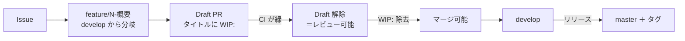

# ブランチ運用方針

Questionnaire の `ブランチ運用方針.md` に則る。**このリポジトリにまだ無いもの**（CodeQL・依存の脆弱性検査・
リリース実行・Dependabot・ラベルと Milestone など）は、載せる段階でこの文書へ足す。

## ブランチの種類

| ブランチ | 役割 |
| --- | --- |
| `develop` | 開発の根幹。**既定ブランチ。** 作業ブランチはここから分岐し、PR の base もここ |
| `master` | リリース確定済みの状態。**直接 PR を向けない。** リリースの取り込みだけが入る（未作成。初回リリース時に作る） |
| `feature/{Issue 番号}-{概要}` / `fix/{Issue 番号}-{概要}` | 作業ブランチ。概要は英小文字のケバブケース |
| `v{X}.{Y}.{Z}`（タグ） | リリース。セマンティックバージョニング。1.0.0 未満は互換を保証しない |

## 全体の流れ



- **Draft 解除＝「レビュー可能」、`WIP:` 除去＝「マージ可能」** の 2 つのゲートとして使い分ける
- PR 本文に `Closes #N` を書く。base は分岐元
- **コミットメッセージに `[skip ci]` を含めない。** 引用しただけでも push 全体の CI がスキップされる

## 守ること

- **ブランチ保護のバイパスを通常運用で使わない。** 管理者はバイパスできてしまう
- 仕様の解釈・外部連携（Pleasanter API）・認証・権限・利用者に見える文言の変更は、レビューを待つ
- 自分でマージしてよいのは、ドキュメントのみの変更、CI で検証できる CI・開発ツールの変更、
  振る舞いを変えないリファクタ、CI が通る依存更新。**迷ったらマージしない**
    - 「ドキュメントのみ」は差分で判定する。設定ファイルやスクリプトが 1 行でも混ざれば対象外

## 作業ツリー（worktree）の切り方

**別ブランチの作業は、メインツリーでブランチを切り替えるのではなく `git worktree` を切って行うこと。**
切り替えると他の作業中の変更やビルド成果物（`bin/` `obj/` `node_modules/`）を壊す。
分岐元から直接 worktree を作れば、切り忘れによる誤ったブランチへのコミットも防げる。

| 項目 | 決まり |
| --- | --- |
| 置き場所 | 本体リポジトリと並列の `VehicleVision.PleasanterTools.CalendarFeed.worktrees/` 配下 |
| ディレクトリ名 | `{Issue 番号}-{概要}`（番号を先頭に置く）。番号が無いときは `unassigned-{概要}` で、採番できたらリネーム |

```bash
git worktree add -b feature/12-feed-store \
    ../VehicleVision.PleasanterTools.CalendarFeed.worktrees/12-feed-store origin/develop
```

- 用が済んだツリーは `git worktree remove <パス>` で片付ける。**未 push の変更があるツリーは消さず、利用者に確認する**
- **マージ済みかどうかは PR の状態と内容で判断する。** squash マージのため `git cherry` や祖先判定は当てにならない

## 一時成果物の置き場所

- 調査メモ・生成したコマンドリスト・検証用スクリプトなど**その場限りの成果物は `temp/{yyyyMMdd}_{内容}/` に出す**
- `temp/` は `.gitignore` 済み。コミットしない。リポジトリ直下や各プロジェクト配下へ直接置かない

## CI の実行条件

| ワークフロー | ジョブ名（必須チェック） | 契機 |
| --- | --- | --- |
| `ci.yml` | `ビルドと単体テスト` | 全ブランチへの push、`develop` / `master` 向けの PR。タグの push では回さない |
| `pr-title-wip-check.yml` | `WIP が外れているか` | `develop` / `master` 向けの PR（タイトルの編集でも再実行）。**コードは実行しない** |

- **登録したジョブ名は以後変更しない**（必須チェックの名前と一致している必要がある）
- `_reference`（Pleasanter 本体・AGPL v3）は CI で取得しない。ビルドにもテストにも要らない
- **結合テスト（4 RDBMS・実機の Pleasanter）は未整備。** 整備したら別ワークフローで足し、必須にする（方針書 9 章）

## ブランチ保護

**Repository rulesets で設定する**（classic branch protection は使わない）。

| ruleset | 対象 | ルール |
| --- | --- | --- |
| `develop-protection` | `refs/heads/develop` | 削除禁止、force push 禁止、**必須ステータスチェック** |
| `master-protection` | `refs/heads/master` | 上記に加えて **PR 必須**（承認 0 件） |
| `release-tag-protection` | `refs/tags/v*` | 削除禁止、force push 禁止 |

- **`master` の PR 必須は承認数 0。** レビューを強制するためではなく、
  リリース確定ブランチへ直接 push が入らないようにするための設定
- **リポジトリ管理者（Repository role の Admin）はバイパスできる。** 緊急時の復旧経路を塞がないため。
  **通常運用でバイパスを使わない**
- `delete_branch_on_merge` を有効にする。マージすると head ブランチが自動削除される
- **ruleset を触るときは、まず現状を GET して差分だけ足すこと。**
  `PUT /repos/{owner}/{repo}/rulesets/{id}` は**送らなかったルールを消す**
  （<https://docs.github.com/en/rest/repos/rules>）

### 必須ステータスチェック

| チェック名 | 出どころ | `develop-protection` | `master-protection` |
| --- | --- | --- | --- |
| `ビルドと単体テスト` | `ci.yml` | 必須 | 必須 |
| `WIP が外れているか` | `pr-title-wip-check.yml` | 必須 | 必須 |

CodeQL と依存の脆弱性検査は、載せるときも**必須にしない**。どちらも「こちらのコードが変わらなくても
赤くなる」検査で、必須にすると、その修正 PR 自体がマージできなくなる。気付くための仕掛けとして扱う。
