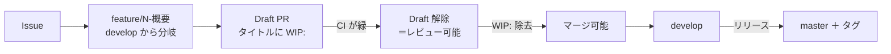

# ブランチ運用方針

Questionnaire の `ブランチ運用方針.md` に則る。**このリポジトリにまだ無いもの**（ラベルと Milestone など）は、
載せる段階でこの文書へ足す。リリースの手順は [`リリース手順書.md`](リリース手順書.md)。

## ブランチの種類

| ブランチ | 役割 |
| --- | --- |
| `develop` | 開発の根幹。**既定ブランチ。** 作業ブランチはここから分岐し、PR の base もここ |
| `master` | リリース確定済みの状態。**直接 PR を向けない。** リリースの取り込みだけが入る（未作成。初回リリース時に作る） |
| `feature/{Issue 番号}-{概要}` / `fix/{Issue 番号}-{概要}` | 作業ブランチ。概要は英小文字のケバブケース |
| `v{X}.{Y}.{Z}`（タグ） | リリース。セマンティックバージョニング。1.0.0 未満は互換を保証しない |

## 全体の流れ



- **Draft 解除＝「レビュー可能」、`WIP:` 除去＝「マージ可能」** の 2 つのゲートとして使い分ける
- PR 本文に `Closes #N` を書く。base は分岐元
- **コミットメッセージに `[skip ci]` を含めない。** 引用しただけでも push 全体の CI がスキップされる

## 守ること

- **ブランチ保護のバイパスを通常運用で使わない。** 管理者はバイパスできてしまう
- 仕様の解釈・外部連携（Pleasanter API）・認証・権限・利用者に見える文言の変更は、レビューを待つ
- 自分でマージしてよいのは、ドキュメントのみの変更、CI で検証できる CI・開発ツールの変更、
  振る舞いを変えないリファクタ、CI が通る依存更新。**迷ったらマージしない**
    - 「ドキュメントのみ」は差分で判定する。設定ファイルやスクリプトが 1 行でも混ざれば対象外

## 作業ツリー（worktree）の切り方

**別ブランチの作業は、メインツリーでブランチを切り替えるのではなく `git worktree` を切って行うこと。**
切り替えると他の作業中の変更やビルド成果物（`bin/` `obj/` `node_modules/`）を壊す。
分岐元から直接 worktree を作れば、切り忘れによる誤ったブランチへのコミットも防げる。

| 項目 | 決まり |
| --- | --- |
| 置き場所 | リポジトリ内の `.worktrees/` 配下（`.gitignore` 済み） |
| ディレクトリ名 | `{Issue 番号}-{概要}`（番号を先頭に置く）。番号が無いときは `unassigned-{概要}` で、採番できたらリネーム |

```bash
git worktree add -b feature/12-feed-store \
    .worktrees/12-feed-store origin/develop
```

- 用が済んだツリーは `git worktree remove <パス>` で片付ける。**未 push の変更があるツリーは消さず、利用者に確認する**
- **マージ済みかどうかは PR の状態と内容で判断する。** squash マージのため `git cherry` や祖先判定は当てにならない

## 一時成果物の置き場所

- 調査メモ・生成したコマンドリスト・検証用スクリプトなど**その場限りの成果物は `temp/{yyyyMMdd}_{内容}/` に出す**
- `temp/` は `.gitignore` 済み。コミットしない。リポジトリ直下や各プロジェクト配下へ直接置かない

## CI の実行条件

| ワークフロー | ジョブ名（必須チェック） | 契機 |
| --- | --- | --- |
| `ci.yml` | `build-test` | 全ブランチへの push、`develop` / `master` 向けの PR。タグの push では回さない |
| `ci.yml` | `frontend` | 同上。管理画面（Svelte）の型検査・単体テスト・組み立て |
| `ci.yml` | `license-check` | 同上。Pleasanter 本体（AGPL v3）の混入を `scripts/license-check.sh` で検査する |
| `pr-title-wip-check.yml` | `wip-title` | `develop` / `master` 向けの PR（タイトルの編集でも再実行）。**コードは実行しない** |
| `dependency-audit.yml` | `notice-consistency` | 全ブランチへの push と週次。`scripts/notice-check.sh` が、直接依存と `NOTICE` の突き合わせをする |
| `markdown-lint.yml` | `markdown-lint` | 全ブランチへの push、`develop` / `master` 向けの PR。`npm run lint:md`（markdownlint の API を直接使う）。必須にはしていない |
| `integration.yml` | `integration` | `develop` / `master` への push と PR |
| `e2e.yml` | `e2e / pleasanter` / `e2e / saml` | `develop` 向けの PR（**paths で絞る**）と `develop` / `master` への push、毎日 |
| `release.yml` | （必須にしない） | `v*` タグの push（`master` に含まれるコミットだけ）。検証して GitHub Release を作る |
| `release-run.yml` | （必須にしない） | 手動。`major`/`minor`/`patch` を選んで採番からタグ push まで通す |
| `e2e-skip.yml` | 同上（同名） | **e2e.yml の paths に当たらない PR で、同名のチェックを成功として報告する**（Pending で止まらないように） |

- **登録したジョブ名は以後変更しない**（必須チェックの名前と一致している必要がある）
- `_reference`（Pleasanter 本体・AGPL v3）は CI で取得しない。ビルドにもテストにも要らない
- ⚠️ **`e2e.yml` の paths を変えたら `e2e-skip.yml` の paths-ignore も揃える。ジョブを足したら両方へ同名で足す。**
  片方だけ直すと、二重に報告されるか、Pending のまま止まる

## ブランチ保護

**Repository rulesets で設定する**（classic branch protection は使わない）。

| ruleset | 対象 | ルール |
| --- | --- | --- |
| `develop-protection` | `refs/heads/develop` | 削除禁止、force push 禁止、**必須ステータスチェック** |
| `master-protection` | `refs/heads/master` | 上記に加えて **PR 必須**（承認 0 件） |
| `release-tag-protection` | `refs/tags/v*` | 削除禁止、force push 禁止 |

- **`master` の PR 必須は承認数 0。** レビューを強制するためではなく、
  リリース確定ブランチへ直接 push が入らないようにするための設定
- **リポジトリ管理者（Repository role の Admin）はバイパスできる。** 緊急時の復旧経路を塞がないため。
  **通常運用でバイパスを使わない**
- `delete_branch_on_merge` を有効にする。マージすると head ブランチが自動削除される
- **ruleset を触るときは、まず現状を GET して差分だけ足すこと。**
  `PUT /repos/{owner}/{repo}/rulesets/{id}` は**送らなかったルールを消す**
  （<https://docs.github.com/en/rest/repos/rules>）

### 必須ステータスチェック

| チェック名 | 出どころ | `develop-protection` | `master-protection` |
| --- | --- | --- | --- |
| `build-test` | `ci.yml` | 必須 | 必須 |
| `frontend` | `ci.yml` | 必須 | 必須 |
| `license-check` | `ci.yml` | 必須 | 必須 |
| `wip-title` | `pr-title-wip-check.yml` | 必須 | 必須 |
| `notice-consistency` | `dependency-audit.yml` | 必須 | 必須 |
| `integration` | `integration.yml` | 必須 | 必須 |
| `e2e / pleasanter` / `（SAML）` | `e2e.yml` / `e2e-skip.yml` | 必須 | **不要**（`develop` 向けの PR だけで回る） |

必須の構成は Questionnaire の `develop-protection` / `master-protection` と同じ
（e2e だけは、こちらが 2 ジョブに分かれている分、2 件）。

`notice-consistency` は「こちらが依存を足した・上げたのに NOTICE を直し忘れた」を止める検査で、
**脆弱性の検査（`nuget-audit` / `npm-audit`）とは別物**（後者は必須にしない）。

CodeQL と依存の脆弱性検査は、**必須にしない**。どちらも「こちらのコードが変わらなくても
赤くなる」検査で、必須にすると、その修正 PR 自体がマージできなくなる。気付くための仕掛けとして扱う。

## 品質の検査（Questionnaire に倣った）

- **CodeQL（`codeql.yml`）**: C# と TypeScript。**解析結果を受け取れるリポジトリ設定（Advanced Security）が無いと、
  前提の確認ジョブが警告を出して解析を飛ばす**（緑に見えても検査していないことがある。実行の要約に出る）。
  クエリは `security-extended`（`.github/codeql/codeql-config.yml`）。`.svelte` は解析されない
- **依存の脆弱性検査（`dependency-audit.yml`）**: `dotnet list package --vulnerable`（推移的な依存を含む。
  終了コードが 0 のままなので JSON を読んで落とす）と `npm audit`。週次でも回す
- **入ってくる依存の確認（`dependency-review.yml`）**: PR の時点で、脆弱性（moderate 以上）とコピーレフトのライセンスを見る。
  依存関係グラフが無効なリポジトリでは動かない場合がある
- **Issue の紐付け（`pr-issue-link-check.yml`）**: `Closes #N` が無い PR へコメントするだけ。止めない
- **Dependabot（`dependabot.yml`）**: NuGet / npm / GitHub Actions を週次。base は `develop`。
  **寛容ライセンス以外が入る更新は採らない**（`NOTICE` と `LICENSING.md`）
- `AGENTS.md` は `.github/copilot-instructions.md` を編集元として `bash scripts/sync-agents.sh` で生成し、
  `bash scripts/sync-agents.sh --check` で検査する。CI の `license-check` でも同期を検査する。
  `.vscode` は無いため VS Code タスクの検査は載せていない

### 参照ソースのオンデマンド取得

- Pleasanter 本体は AI の事実確認専用。`bash scripts/sync-reference.sh` で読む前に上流 `main` を取得する。
  Git では追跡せず、日次追従・ポインタ更新 PR は作らない。CI に本体取得を追加しない
- 共有取得先は `PLEASANTER_REFERENCE_DIR` で指定して直接読む。リンクは作らない。
  詳細は [`_reference/README.md`](../_reference/README.md)
- 根拠は確認した完全な SHA・固定リンク・参照日で残す。`main` はリリース前の変更を含む。
  過去の実機検証結果は当時の記録として維持し、新しい版を確認したことにはしない
- `license-check` ジョブは従来のデュアルライセンス検査を維持し、
  `reference-isolation-check.sh`・ネットワーク不要の `test-sync-reference.sh`・規約同期検査を追加する。
  CodeQL・Docker の `_reference` 除外、各 checkout の `submodules: false` も維持する
- 削除した日次 workflow の既存ブランチ・Draft PR・Issue はこの移行では触らない。
  patch 更新など他用途の bot と GitHub 設定・ルールセット・App・資格情報は変更しない

```bash
bash scripts/sync-agents.sh
bash scripts/sync-agents.sh --check
bash -n scripts/sync-reference.sh
bash scripts/test-sync-reference.sh
bash scripts/reference-isolation-check.sh
bash scripts/license-check.sh
npm run lint:md
dotnet build -c Release
dotnet test --no-build -c Release
git diff --check
```

取得確認は `PLEASANTER_REFERENCE_DIR` を専用の一時取得先へ向け、`bash scripts/sync-reference.sh` を
2 回実行して再実行できることを確認する。その環境変数を設定したまま隔離検査も実行する。
既存の管理画面検査・4 種 DB の結合試験・E2E の契約は変更しない。
