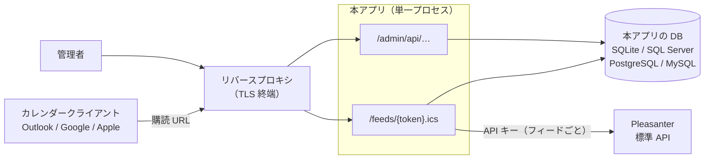
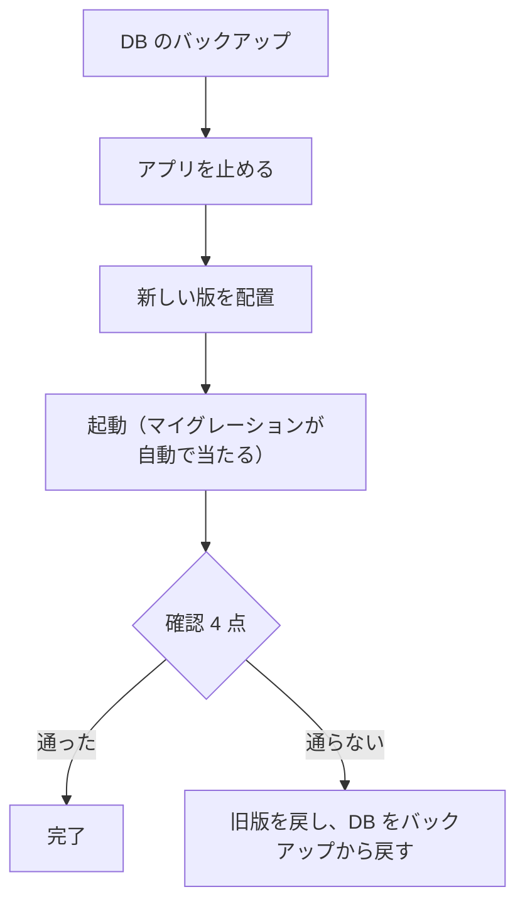

# 導入・更新運用手順書

**本アプリ（CalendarFeed）の導入・日常運用・更新・困ったときの手順。**
設計は [`アーキテクチャ方針.md`](アーキテクチャ方針.md)、実機で確かめた Pleasanter の挙動は [`実機検証結果.md`](実機検証結果.md)。
設定の一覧は [`App_Data/Parameters/README.md`](../src/VehicleVision.PleasanterTools.CalendarFeed.Web/App_Data/Parameters/README.md)。

> 書いてあるのは、ソース・テスト・実機（Pleasanter 1.5.8.1 ＋ 4 種の RDBMS ＋ 起動したアプリ）で確かめたことだけ。
> **確かめていないことは「未確認」と書いてある。**

## 1. 全体像



- **Pleasanter の DB とは別に、本アプリ専用の DB を作る。**
- **単一プロセスが前提。** 複数インスタンスの同時起動時のマイグレーションの排他は無い（6 章）。
- 管理画面（UI）は未実装。管理は API（cookie ＋ 2 要素のログイン）で行う。

## 2. 導入の前に決めること・用意するもの

| 項目 | 内容 |
| --- | --- |
| Pleasanter の API キー | **フィードごとに 1 本。** 見える範囲は、そのキーの利用者の権限で決まる（3 章） |
| API キー利用者のタイムゾーン | **運用の標準タイムゾーン（日本なら `Tokyo Standard Time`）にしておく。** `UTC` のままだと日付だけのレコードが 0:00 に読めず、終日の自動判定が効かない（[実機検証結果 1 章](実機検証結果.md)）。**運用開始後に変えない** |
| 本アプリの公開 URL | `CALENDARFEED_PUBLIC_BASEURL`。**HTTPS にする。** 管理者の cookie の `Secure` の判定にも使う（7 章） |
| RDBMS | Pleasanter が使うものに合わせる。**本番に SQLite は使わない** |
| 秘密の鍵 | `CALENDARFEED_SECRET_KEY`。**デプロイ先の秘密の保管先（環境変数）へ置く。** 失うと保管した API キーと管理者の 2 要素の共有鍵を復号できない（8 章） |
| サーバの時計 | **NTP で合わせる。** TOTP は前後 30 秒までのずれしか許さない |

## 3. Pleasanter 側の準備

1. **フィード用の利用者を作り、API キーを発行する。** `Users.TimeZone` を運用の標準タイムゾーンにする。
2. **その利用者に、フィードに出すサイトの読み取り権限を与える。** 見せたくないサイトは権限を与えない（これがフィード間の分離になる）。
3. **件名・場所・説明で選択肢・リンク・ユーザーの列を使うなら、リンク先サイトの読み取り権限も要る。**
   解決は API キーの利用者の権限の範囲でしか効かない（ソース上の根拠。リンク列の解決は**未確認**）。
4. 項目拡張（`Date001` 以降など）を使うなら、Pleasanter 側で拡張を有効にしておく。
   `trial` の CodeDefiner は既定で `Class` しか拡張しない（[実機検証結果 6 章](実機検証結果.md)）。
5. 数値の小数桁は Pleasanter の列の設定で決まる（既定 0。保存時に丸められる）。小数を出すなら、Pleasanter 側で桁を増やす。

> **Pleasanter の API 回数制限**を超えないよう、生成した `.ics` は 300 秒キャッシュする（`Feed.json` の `CacheSeconds`）。
> 制限を超えたときの挙動は**未確認**。

## 4. 導入

### 4.1 DB を作る

| RDBMS | 手順 |
| --- | --- |
| SQLite | 何もしない（`App_Data/calendarfeed.db`。簡易用） |
| SQL Server | **データベースを先に作る**（マイグレーションは作らない）。接続文字列の `Encrypt=False` は無視して暗号化する。証明書の確認を緩めるなら `TrustServerCertificate=True` |
| PostgreSQL | データベースを作る |
| MySQL | **`utf8mb4` のデータベースを作る**（`CREATE DATABASE calendarfeed CHARACTER SET utf8mb4 COLLATE utf8mb4_0900_as_cs;`）。表はマイグレーションが `utf8mb4` へ直す |

### 4.2 設定する

秘密の値は**環境変数**で与える（`App_Data/Parameters/*.json` へ実値を書かない。`*.local.json` はローカル開発用）。

```bash
export CALENDARFEED_PUBLIC_BASEURL=https://calendar.example.com
export CALENDARFEED_PLEASANTER_BASEURL=https://pleasanter.example.com
export CALENDARFEED_PLEASANTER_TIMEZONE=Asia/Tokyo         # 既定のタイムゾーン（フィードごとに上書きできる）
export CALENDARFEED_DB_PROVIDER=PostgreSql                 # Sqlite / SqlServer / PostgreSql / MySql
export CALENDARFEED_DB_CONNECTIONSTRING='Host=…;Database=calendarfeed;Username=…;Password=…'

# 秘密の鍵（フィードごとの API キーと管理者の TOTP の共有鍵を暗号化する）。1 度だけ作って保管する
dotnet run --project src/VehicleVision.PleasanterTools.CalendarFeed.Web -- --generate-secret-key
export CALENDARFEED_SECRET_KEY=<出力された値>
```

- 設定ファイルの置き場と見つかったファイルは、**起動時にログへ出る**（1 つも無ければ警告）。
- `CALENDARFEED_ADMIN_TWOFACTOR` は `required` / `optional`（既定）/ `disabled`。**知らない値は起動時に落ちる。**
  導入時は `required` を勧める（登録するまでログインが完了しない）。

### 4.3 起動する

```bash
dotnet publish src/VehicleVision.PleasanterTools.CalendarFeed.Web -c Release -o publish
ASPNETCORE_URLS=http://localhost:5000 dotnet publish/VehicleVision.PleasanterTools.CalendarFeed.Web.dll
```

> 配布用の成果物（ZIP・コンテナイメージ）は**まだ無い**。`dotnet publish` で作る。サブパス配置（`/calendarfeed/` など）は**未対応**
> （管理者の cookie の `Path` が `/admin` 固定のため）。

- **マイグレーションは起動時に自動で当たる。** 無効にするなら `CALENDARFEED_DB_AUTOMIGRATE=false`（その場合は手で当てる必要がある）。
- プロキシを通す前に、**ローカルで次の 4.4 まで済ませる**（空の状態を公開しない）。

### 4.4 最初の管理者を作る

**管理者が 1 人も居ないときだけ**作れる。**公開する前に作る**（空の状態を放置すると、最初に来た人が管理者になる）。

```bash
B=http://localhost:5000
curl -c jar -X POST $B/admin/api/setup -H "Content-Type: application/json" \
  -d '{"loginId":"admin","password":"<12 文字以上のパスワード>"}'   # 201。2 回目は 409
```

- パスワードの条件は `Security.json`（最低 12 文字。ログイン ID と同じは不可）。
- **作った後はすぐログインして 2 要素を登録する**（4.5）。

### 4.5 ログインして 2 要素を登録する

```bash
curl -b jar -c jar -X POST $B/admin/api/login -H "Content-Type: application/json" \
  -d '{"loginId":"admin","password":"<パスワード>"}'
# → {"step":"enroll"}（required）または {"step":"done"}（optional で未登録）

curl -b jar -c jar -X POST $B/admin/api/me/totp/begin        # {"secret":"…","uri":"otpauth://…"}
# 認証アプリ（Google Authenticator など）へ uri か secret を登録し、表示された 6 桁を送る
curl -b jar -c jar -X POST $B/admin/api/me/totp/complete -H "Content-Type: application/json" \
  -d '{"code":"123456"}'                                     # {"recoveryCodes":[…10 本…]}
```

- **復旧コード 10 本はこのとき 1 度だけ表示される。** 紙か秘密の保管先へ。**使い切り。** 端末を失ったときの唯一の入口（8 章）。
- 登録し直すと、前の復旧コードは消える。

### 4.6 フィードを作る

```bash
curl -b jar -X POST $B/admin/api/feeds -H "Content-Type: application/json" \
  -d '{"name":"共有予定","siteId":123,"apiKey":"<Pleasanter の API キー>","apiKeyUserTimeZoneId":"Asia/Tokyo","language":"ja"}'
# → {"feed":{…,"hasApiKey":true,"apiKeyHint":"e1f6"},"url":"https://…/feeds/<トークン>.ics"}
```

- **応答の `url`（購読 URL）はこのとき 1 度だけ得られる。** トークンは DB に SHA-256 しか置かないので、後から取り出せない（失くしたら再発行）。
- **API キーは登録後は返さない**（`hasApiKey` と末尾 4 文字だけ）。
- 列の対応・書式・テンプレートの書き方は [`アーキテクチャ方針.md`](アーキテクチャ方針.md) 4 章。

| `mapping` の例 | 意味 |
| --- | --- |
| 指定なし | 件名は Pleasanter が組み立てたタイトル（`ItemTitle`）、開始 `StartTime`、終了 `CompletionTime`、説明 `Body` |
| `{"startColumn":"DateA","endColumn":"Date001"}` | 開始・終了に日付の列 |
| `{"summaryTemplate":"{ClassA}：{Title}（{DateB:yyyy/MM/dd}）"}` | 件名を列の組み合わせで作る。**日付・数値には書式が必須** |
| `{"startColumn":"DescriptionA","startFormat":"yyyy/MM/dd HH:mm"}` | 文字の列に入った日付を書式で読む。**書式に合うレコードだけが出る**（形式を揃えて入力する） |
| `"allDay":"Never"` / `"Always"` | 終日の判定（既定 `Auto`＝開始が 0:00 で終了が無いか 0:00 なら終日） |

### 4.7 カレンダーへ登録する

購読 URL を、各カレンダーの「URL から購読」（インターネットカレンダー）へ貼る。

- 本アプリは `REFRESH-INTERVAL` と `X-PUBLISHED-TTL`（既定 5 分）を返し、`ETag` に対応する。**更新の間隔はクライアントが決める**。
  各クライアントがどの間隔で取りに来るかは**未確認**。
- 購読 URL は**パスワードと同じ扱い**（知っていれば誰でも読める）。共有するときは相手を限る。

## 5. 日常運用

| やること | 方法 | 備考 |
| --- | --- | --- |
| Pleasanter の API キーを差し替える | `PUT /admin/api/feeds/{id}/apikey` `{"apiKey":"…","apiKeyUserTimeZoneId":"…"}` | 生成済みの `.ics` のキャッシュは捨てられる。**タイムゾーンを変えると全予定の時刻がずれる**ので、API キー利用者の変更時以外は変えない |
| 購読 URL が漏れた | `POST /admin/api/feeds/{id}/rotate` | **旧 URL はその場で使えなくなる。** 新しい URL を購読者へ配り直す |
| フィードを止める | `DELETE /admin/api/feeds/{id}` | 以後 404 |
| フィード・API キーの確認 | `GET /admin/api/feeds/` | トークンも API キーも出ない |
| 自分のパスワードを変える | `POST /admin/api/me/password` | **他の端末のセッションが失効する** |
| 管理者のログアウト | `POST /admin/api/logout` | サーバ側のセッションがその場で失効する |

- **管理者の棚卸し**: Pleasanter のユーザーとは連動しない。管理者の追加・無効化・最終ログインの一覧は**未実装**（Issue #26）。
- **管理者の操作・ログインの履歴（監査ログ）は DB の `AuditLogs` に残る。** ログイン・ログアウト・失敗・締め出し・復旧コードの使用、
  パスワード変更、2 要素の登録・解除、フィードの作成・トークン再発行・API キーの差し替え・失効。
    - **失敗も残す。** ログイン失敗には理由（`unknown-user` / `bad-password` / `disabled` / `locked`）が `Detail` に入る（外への応答は同じ）。
    - **パスワード・API キー・トークン・復旧コード・TOTP の数字は残さない。** 利用者が打ち込んだ**ログイン ID は、居ない ID でも残る**
      （総当たりの追跡のため）。ログイン ID の欄へパスワードを打ち間違えた場合は、それが残り得る点に注意する。
    - 読むのは `GET /admin/api/audit-logs/`（ログイン済みの管理者のみ。新しい順。`limit`・`before`（前のページの最後の `occurredAt`）・
      `admin`・`action`・`failed=true` で絞る）。管理画面での閲覧は Issue #30。
    - **残す日数は `CALENDARFEED_AUDITLOG_RETENTION_DAYS`（既定 365。`0` なら消さない）。** 6 時間ごとに古い記録を消す。
      法令・社内規程で期間が決まっているなら合わせる。消さない設定にすると、表は増え続ける。

## 6. 更新とロールバック



1. **DB のバックアップを取る。**
2. アプリを止め、新しい版を配置して起動する。**マイグレーションは起動時に自動で当たる。**
3. 確認する: ①起動ログに `DB:` が出てエラーが無い ②`GET /admin/api/status` が 200 ③管理者がログインできる ④購読 URL で `.ics` が取れる。
4. **ロールバック＝旧版のバイナリ ＋ バックアップから DB を戻す。** マイグレーションの `Down` は用意してあるが、**自動では実行しない**（実行は `MigrateUp` だけ）。
5. **複数インスタンスにするとき**: マイグレーションの排他は無い（同時に当てると「表が既にある」で落ちる。テストで再現した）。
   **先に 1 台だけ起動して当ててから増やす。** 2 台目以降は `CALENDARFEED_DB_AUTOMIGRATE=false` でもよい。
   `.ics` のキャッシュはプロセスごと（共有しない）。管理者のセッションは DB なので共有される。

## 7. リバースプロキシ・HTTPS

- **TLS はプロキシで終端してよい。** 本アプリの cookie の `Secure` は、**要求が HTTPS か、`CALENDARFEED_PUBLIC_BASEURL` が `https://` のとき**に付く。
  プロキシ配下では要求が HTTP で届くので、**公開 URL を `https://` で設定する**（これを忘れると、cookie に `Secure` が付かない）。
- ⚠️ **プロキシの背後では、レート制限が全員で 1 つの枠になる**（Issue #31）。本アプリは `X-Forwarded-For` をまだ解釈せず、
  クライアントの IP としてプロキシの IP を見る。
    - 管理者のログイン: **5 分に 10 回**で全員が 429
    - 購読フィード: **1 分に 60 回**で全購読者が 429
  Issue #31 が入るまでは、購読者が多い構成ではプロキシ側で**購読フィードのレート制限を別に持つ**ことを検討する。
- **購読 URL のトークンが、プロキシ・Web サーバのアクセスログに残る**（パスに `/feeds/<トークン>.ics` が入る）。
    - アプリのログには出さない（`Microsoft.AspNetCore.Hosting.Diagnostics` を Warning にしてある）。
    - プロキシのログは**アクセスできる人を限り、保管期間を短くする**。Nginx ならパスを伏せて記録する設定が書ける（下は**動作未確認の例**）。
      IIS・Azure のログでの伏せ方は**未確認**。

```text
# Nginx の例（動作未確認）。/feeds/<トークン>.ics を /feeds/[masked].ics として記録する
map $request_uri $masked_uri {
    ~^/feeds/[^/?]+\.ics$  /feeds/[masked].ics;
    default                $request_uri;
}
log_format masked '$remote_addr [$time_local] "$request_method $masked_uri" $status $body_bytes_sent';
access_log /var/log/nginx/calendarfeed.access.log masked;
```

## 8. 困ったとき

### 8.1 秘密の鍵を失った・変えた

`CALENDARFEED_SECRET_KEY` を失う、または変えると、DB に保管した**暗号文を復号できない**。

| 影響 | 症状 | 対処 |
| --- | --- | --- |
| フィードごとの API キー | 購読 URL が **502**（ログに `フィード … の API キーを復号できません`） | **API キーを登録し直す**（`PUT /admin/api/feeds/{id}/apikey`）。Pleasanter 側のキーはそのまま使える |
| 管理者の TOTP の共有鍵 | TOTP のログインが通常の失敗（401）になり、ログに `TOTP の共有鍵を復号できません` | **復旧コードで入る**（復旧コードは鍵に依存しない。テストで確認）。入ったら **2 要素を登録し直す**（4.5。古い共有鍵は上書きされる） |

- **鍵の保管が最大の予防。** コンテナ・ディスクが作り直されても残る保管先（アプリケーション設定・Key Vault の参照など）へ置く。
- **鍵のローテーション（再暗号化）は未対応。** 鍵を変える＝全フィードの API キーの登録し直し。
- 復旧コードも失くした場合は 8.2 の DB 操作しかない。

### 8.2 管理者のパスワードを忘れた・全員がログインできない

管理者のパスワードのリセット（管理者が他の管理者を直す）は**未実装**（Issue #26）。**最後の手段は DB の操作**（**必ずバックアップを取ってから**）。

```sql
DELETE FROM "AdminRecoveryCodes";
DELETE FROM "AdminSessions";
DELETE FROM "AdminUsers";
DELETE FROM "AdminSetup";
```

- 識別子の引用符は RDBMS による（SQL Server は `[AdminUsers]`、MySQL は `` `AdminUsers` ``）。
- **フィードと API キーは消えない。** 消したあと、4.4 から最初の管理者を作り直す。
- 同じ 4 表を空にして最初の管理者を作り直せることは、4 種の RDBMS のテストで確認している。
- 管理者を作り直すまで、管理 API は 401 のまま（購読フィードは影響を受けない）。

### 8.3 応答の意味

| 応答 | 場所 | 意味と対処 |
| --- | --- | --- |
| 404 | 購読 URL | トークンが違う・フィードが失効した・トークンを再発行した。**どれも同じ 404**（有効なトークンを推測させない） |
| 502 | 購読 URL | API キーが未登録で共通の既定も無い／API キーが Pleasanter に拒否された（失効・権限）／API キーを復号できない（8.1）。ログに理由（フィード ID つき） |
| 503（`Retry-After: 60`） | 購読 URL | Pleasanter に接続できない・Pleasanter が一時的に不調 |
| 429 | 購読 URL・ログイン | レート制限。**プロキシ配下では全員で共有**（7 章） |
| 304 | 購読 URL | 前回と同じ内容（`ETag`）。正常 |
| 401 | 管理 API | ログインしていない／セッションの期限切れ（8 時間）／2 要素の途中（Pending）で操作しようとした |
| 401 | ログイン | **理由は伝えない**: ID が無い・無効・締め出し中・パスワードが違う・数字が違う・同じ時間枠の数字（盗み見の再利用）。**5 回失敗で 15 分締め出す**（恒久的ではない） |
| 403 | 管理 API | 別のサイトからの要求（`Origin` / `Sec-Fetch-Site`）。ブラウザ経由でなければ出ない |
| 予定が出ない・時刻がずれる | `.ics` | 開始が未設定／文字の日付が書式に合わない（そのレコードだけ出ない）。時刻のずれは API キー利用者のタイムゾーンと設定の不一致（2 章） |

### 8.4 ログに出るもの

| ログ | 意味 |
| --- | --- |
| `設定ファイルの置き場 … 見つかったファイル …` | 設定の読み込み。**空なら置き場を確かめる** |
| `管理者 … を … まで締め出しました` | ログイン・数字の失敗が続いた |
| `管理者 … が復旧コードでログインしました` | 復旧コードの使用。**心当たりが無ければ調べる** |
| `フィード … の取得に失敗しました（…）` | Pleasanter の失敗（種類つき）。**API キー・トークンは出ない** |

## 9. 参照した根拠

- 起動・設定・マイグレーション: `Web/Program.cs`、`Web/Services/ParameterFiles.cs`、`Data/DatabaseMigrator.cs`
- 管理者認証: `Web/Endpoints/AdminAuthEndpoints.cs`、`Web/Services/AdminSessionGuard.cs`、`Data/AdminStores.cs`
- 鍵を失ったとき: `Web.Tests/AdminAuthEndpointTests.cs` の `AdminLostSecretKeyTests`（2026-10-13）
- DB 操作で作り直せること: `Core.Tests/AdminStoreTests.cs`（4 種の RDBMS）
- Pleasanter の挙動: [`実機検証結果.md`](実機検証結果.md)（Pleasanter 1.5.8.1、2026-10-12）
